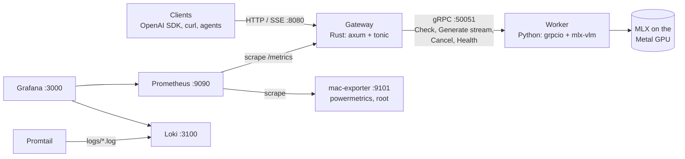
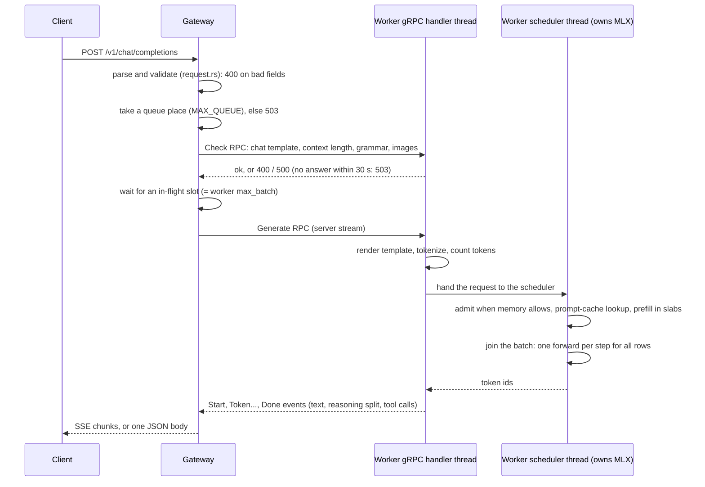

# Tutorial: serving LLMs locally on Apple Silicon with this repo

This guide takes you from a fresh clone to a running OpenAI-compatible server on a Mac. It
also explains how the server uses memory, which knobs matter and why, and how to operate,
measure and extend it. Read it top to bottom once (30–45 minutes). After that, use it as a
reference.

Where to look for more:

- [`README.md`](../README.md): the full API notes and every feature in detail.
- [`CLAUDE.md`](../CLAUDE.md): dense engineering notes. They hold the design decisions, the
  performance history and the complete env-knob table.
- [`docs/perf/`](perf/README.md): one folder per measurement campaign, with the reports,
  raw data and dead ends.

Conventions used below:

- Commands run from the repository root unless a `cd` says otherwise.
- `zsh` is the shell. Any POSIX shell works, but see [§9](#9-benchmarking-correctly) about
  zsh and background jobs.
- **Every performance number is a measurement on one M1 Max with 32 GB**, against the pinned
  library versions, on the date and model given next to it. Your machine will differ. The
  machine itself drifts ±20–30 % from minute to minute (see [§9](#9-benchmarking-correctly)).

---

## Contents

1. [What it is and when to use it](#1-what-it-is-and-when-to-use-it)
2. [Installation](#2-installation)
3. [Getting a model](#3-getting-a-model)
4. [First run](#4-first-run)
5. [Memory on a 32 GB Mac](#5-memory-on-a-32-gb-mac)
6. [Using the API](#6-using-the-api)
7. [Performance features](#7-performance-features)
8. [Observability and operations](#8-observability-and-operations)
9. [Benchmarking correctly](#9-benchmarking-correctly)
10. [Development](#10-development)
11. [Troubleshooting and FAQ](#11-troubleshooting-and-faq)
12. [Env-knob quick reference](#12-env-knob-quick-reference)

---

## 1. What it is and when to use it

### 1.1 In one paragraph

The project serves local LLM inference on Apple Silicon with [MLX](https://github.com/ml-explore/mlx).
It has two processes:

- A **Rust gateway** speaks the OpenAI chat-completions API over HTTP and SSE. It queues
  requests, exports Prometheus metrics and writes structured logs.
- A **Python worker** loads one model with
  [mlx-vlm](https://github.com/Blaizzy/mlx-vlm) and generates tokens.

The two talk over **gRPC**. The worker's inference engine is far more than a library call:

- **continuous batching** of up to 16 requests;
- a **prompt cache** built for hybrid (Gated DeltaNet + attention) models;
- **speculative decoding** with DFlash drafters;
- custom **Metal matmul kernels** for M1-class GPUs;
- **constrained decoding** for JSON schemas and tool calls;
- **log-probabilities** of generated and prompt tokens.

An optional Docker stack (Prometheus, Grafana, Loki, Promtail) gives you dashboards and log
search.

> **Status.** This is a research project, published as is. It was built and measured on one
> machine (M1 Max, 32 GB) against pinned versions: mlx 0.32.3 and mlx-vlm 0.7.6. The worker
> patches mlx-vlm classes at run time, so other versions are expected to break. There is no
> support and no stability promise.

### 1.2 Compared with llama.cpp, vLLM and the mlx-lm / mlx-vlm servers

| you want… | consider |
|---|---|
| the widest model coverage, GGUF files, a single binary | `llama.cpp` / `llama-server` |
| a quick single-user server over any MLX model | the stock `mlx-lm` / `mlx-vlm` servers |
| a big CUDA server | vLLM: its OpenAI behaviour (v0.30) is the reference this gateway copies |
| **many concurrent requests or agent loops on a Mac, with long shared prompts, tools, JSON schemas, reasoning control, metrics, on the Qwen3.5-architecture models** | **this project** |

What you get here and not from a stock MLX server:

- **Throughput under concurrency.** On 2026-10-12 the 9B, through the gateway, produced
  about 31 tok/s for 1 client. With 8 clients it produced 110 tok/s with batching and
  31.8 tok/s with requests served one at a time.
- **Prompt reuse that works on hybrid models.** Their recurrent state cannot be rewound, so
  the worker checkpoints it.
- **vLLM-compatible request semantics.** Unsupported fields are refused with a 400, never
  silently ignored.

What you give up:

- **Model coverage.** Only the `qwen3_5` / `qwen3_5_moe` architecture in mlx-vlm is supported
  (see [§3](#3-getting-a-model)).
- **Security.** There is no auth and no TLS (see [§6.13](#613-security-note)).
- **Library choice.** The library versions are pinned.

### 1.3 Architecture



Some design rules are fixed:

- **Rust everywhere except where MLX must load.** The worker is a separate process; there are
  no Python bindings inside the gateway.
- **`src/proto/worker.proto` is the single source of truth** for the wire contract. Both
  sides generate code from it.
- **Inference runs natively.** Metal is not available inside Docker, so only the
  observability stack is containerized.
- **Images travel as paths or URLs, never as bytes.** `data:` URIs are decoded to temporary
  files by the worker.
- **One worker holds one model copy.** On 32 GB only one 18 GB model fits, so concurrency
  comes from batching inside that worker, not from a pool of workers.

### 1.4 Life of a request



The **gateway** (`src/gateway/src/`) does the HTTP-side work:

- validates the request the way vLLM does;
- maps OpenAI fields onto the proto;
- holds two semaphores: a queue bound (`MAX_QUEUE`) and an in-flight bound (the worker's
  `max_batch`);
- converts worker events into OpenAI chunks;
- cancels the worker-side generation when the client disconnects.

The **worker** keeps a strict split between threads:

- **gRPC handler threads** render the chat template, tokenize, preprocess images, and turn
  token ids into text. That includes detokenizing, stop strings, the reasoning/content
  split and tool-call parsing.
- **One scheduler thread** owns every MLX operation: admission, prefill, the batched decode
  step, sampling and prompt-cache stores. Running MLX on two threads at once crashed in
  tests, so this rule is absolute.

---

## 2. Installation

### 2.1 Requirements

| what | why | how |
|---|---|---|
| Apple Silicon Mac | Metal GPU; everything was measured on an M1 Max 32 GB | — |
| Rust (stable) | gateway and exporter | `curl https://sh.rustup.rs -sSf \| sh` |
| `protoc` | `tonic-build` / `prost-build` compile the proto at build time | `brew install protobuf` |
| [uv](https://docs.astral.sh/uv/) | both Python projects | `curl -LsSf https://astral.sh/uv/install.sh \| sh` |
| `aria2c` | `scripts/hf_pull.sh` (optional) | `brew install aria2` |
| Docker | the observability stack (optional) | Docker Desktop or similar |

Python itself comes from uv. The worker needs Python ≥ 3.11 and the root tooling project
needs ≥ 3.12.

### 2.2 The two Python projects

There are **two separate uv projects**, on purpose:

| project | `pyproject.toml` | contents | used for |
|---|---|---|---|
| worker runtime | `src/worker/` | `mlx==0.32.3`, `mlx-vlm==0.7.6`, `grpcio`, `llguidance`, `transformers`, `protobuf`; groups `proto` (grpcio-tools) and `dev` (pytest) | the worker, its tests, the perf scripts |
| root tooling | repo root | `huggingface-hub`, `hf-transfer`, `mlx-lm`, `mlx-vlm` (unpinned) | `chat.py`, downloads |

They are not merged, so the worker's runtime environment stays isolated from tooling. Each
one gets its own `.venv` the first time you `uv run` inside it, or explicitly:

```zsh
uv sync                       # root tooling env
(cd src/worker && uv sync)    # worker env
```

A venv contains absolute paths. If you move the checkout, run `uv sync` again in both places.

### 2.3 Generate the gRPC stubs (worker side)

The Python stubs are git-ignored and generated from the proto:

```zsh
cd src/worker
uv run --group proto bash gen_proto.sh     # writes worker_pb2.py, worker_pb2_grpc.py
```

Run this once, and again after any change to `src/proto/worker.proto`.

### 2.4 Build the gateway (and the exporter)

```zsh
cargo build --release
# -> target/release/qwen-gateway, target/release/qwen-mac-exporter
```

The gateway's `build.rs` compiles `../proto/worker.proto` with tonic-build, so a proto
change is picked up by the next `cargo build`.

---

## 3. Getting a model

### 3.1 Supported models

The worker needs mlx-vlm's `qwen3_5` architecture (`qwen3_5_moe` for the MoE). This is a
**hybrid**: Gated DeltaNet (linear-attention) layers with a fixed-size recurrent state, plus
a full-attention layer every 4th layer, which holds a KV cache that grows with the context.
The checkpoints the project was built on and measured:

| weights dir | model | quant | size | notes |
|---|---|---|---|---|
| `ornith15-9b-mlx-8bit` | Ornith-1.5-9B (`ornith-ai/Ornith-1.5-9B-MLX-8bit`) | MLX 8-bit g64 | ~9.5 GB | dense, **text-only** (images → 400); the everyday model; ~37 tok/s solo decode |
| `ornith10-9b-mlx-8bit` | Ornith-1.0-9B | MLX 8-bit g64 | ~10.4 GB | dense, vision-language |
| `qwen38-27b-mlx-5bit` | Qwen3.8-27B (`lmstudio-community/Qwen3.8-27B-MLX-5bit`) | MLX 5-bit g64 | ~18.1 GB | dense hybrid VL, 64 layers, native 256K context; DFlash needs `QWEN_MRQMM5=1` |
| `qwen38-27b-mlx-4bit` | Qwen3.8-27B (`lmstudio-community/Qwen3.8-27B-MLX-4bit`) | MLX 4-bit g64 | ~16.1 GB on disk, 14.1 GiB loaded text-only | the long-context 27B: with `QWEN_TEXT_ONLY=1` + the drafter 15.4 GiB resident, an 80K-token prompt peaks at 23.7 GiB; DFlash needs `QWEN_MRQMM4=1` |
| `qwen36-35b-a3b-mlx-ud3` | Qwen3.6-35B-A3B | MLX 3-bit "Unsloth Dynamic" (mixed per layer) | ~16 GB | VL MoE, 256 experts, ~3B active |

Optional DFlash **drafters** for speculative decoding (see [§7.7](#77-dflash-speculative-decoding)):

| weights dir | drafter | target |
|---|---|---|
| `qwen35-9b-dflash` | `z-lab/Qwen3.5-9B-DFlash` | the 9B models (trained on base Qwen3.5-9B; works on the Ornith finetunes) |
| `qwen38-27b-dflash2` | `z-lab/Qwen3.8-27B-DFlash2` | the 27B |

**27B: 5-bit or 4-bit?** Measured on an M1 Max 32 GB (2026-11-15, greedy, ~2K-token
prompt, no thinking, in one process): the 4-bit model decodes 17.2 tok/s plain and 37.7 tok/s
with the DFlash2 drafter (4.8 tokens accepted per round, output identical to plain greedy), where
the 5-bit one did 13.3 / 23.4 (2026-11-11). The 4-bit weights are 3.1 GiB smaller, which is
~50K tokens of fp16 KV. The 5-bit model is the more faithful one (5 vs 4 bits per weight); a
teacher-forced comparison of the two is in progress (`scripts/perf/prof/kl_models.py`). The
three popular 4-bit MLX uploads of this model (lmstudio-community, mlx-community, TensorFold)
use the same plain round-to-nearest 4-bit g64 scheme; mlx-community's and TensorFold's files are
byte-identical.

**Text-only use of a vision-language checkpoint.** `QWEN_TEXT_ONLY=1` skips the vision tower
(333 tensors, ~0.86 GiB on the 27B, never read from disk); image requests then get the same 400
as on a text-only checkpoint.

**Which quantizations run fast.** Any MLX affine quantization of a `qwen3_5` /
`qwen3_5_moe` checkpoint should load, including mixed-precision ones (per-module bits in
`config.json`). The custom decode kernel (`mrqmm`, multi-row matmul for batched decode and
DFlash verify blocks) covers 8-bit modules by default and 5-bit / 4-bit modules behind
`QWEN_MRQMM5` / `QWEN_MRQMM4`; modules at any other width (3, 6 bits) fall back to MLX's
`quantized_matmul`, which makes a DFlash verify block several times slower on them. The fused
decode in-projection of a Gated DeltaNet layer (`QWEN_GDN_FUSE`) needs its four projections at
the same bit width; mixed layers keep four separate matmuls. The prefill kernel (`pfqmm`) is
self-tested per (bits, group) and covers 3, 4, 5, 6 and 8 bits.

Only the checkpoints above were measured. Other architectures are not supported. At best the worker runs
them without batching: it logs `… is not a qwen3_5 / qwen3_5_moe model: no batching` and
falls back to `QWEN_MAX_BATCH=1`.

Model cards' benchmark claims are not verified here; evaluate empirically. For example, on
five coding tasks (temperature 0) Ornith-1.5 was at least as good as 1.0 and answered more
cleanly. It also thinks 2–5× longer on trivial prompts.

### 3.2 Downloading with `scripts/hf_pull.sh`

`scripts/hf_pull.sh <repo_id> <dest_dir>` is a resumable downloader for a Hugging Face model
repo:

- it asks the Hub's tree API for every file and its LFS sha256;
- it downloads each file with `aria2c` (several connections, infinite retries);
- it verifies each file against its checksum;
- it skips files that are already complete.

It reads your token from `~/.cache/huggingface/token`. Create that file once with
`uv run hf auth login` in the root env.

```zsh
scripts/hf_pull.sh ornith-ai/Ornith-1.5-9B-MLX-8bit     weights/ornith15-9b-mlx-8bit
scripts/hf_pull.sh z-lab/Qwen3.5-9B-DFlash              weights/qwen35-9b-dflash        # optional
scripts/hf_pull.sh lmstudio-community/Qwen3.8-27B-MLX-5bit weights/qwen38-27b-mlx-5bit  # optional
```

If it is interrupted, re-run the same line. Finished files are skipped, and aria2c resumes
partial ones. Stop it with Ctrl-C rather than `kill -9`, which can leave orphaned partial
files behind.

You can also use `uv run hf download <repo> --local-dir weights/<dir>` from the root env.
MLX loads from a plain directory, and no Hugging Face cache is needed at run time.

### 3.3 Weights layout and the model id

`weights/` is git-ignored. Each model is a plain directory: `config.json`, the tokenizer
files, `*.safetensors` shards, and for VL checkpoints `preprocessor_config.json`.

**The model id is the directory name.** The worker reports `ornith15-9b-mlx-8bit`, for
example. That id appears in `/v1/models` and in the `"model"` field of every response.
Requests must name it or an alias (see [§6.12](#612-model-names)).

---

## 4. First run

This walk-through uses Ornith-1.5 9B. It needs no special memory setup on 32 GB.

### 4.1 Start the worker

```zsh
cd src/worker
QWEN_MODEL=../../weights/ornith15-9b-mlx-8bit QWEN_KV_BITS=0 QWEN_PROMPT_CACHE=1 \
  uv run python worker.py
```

- `QWEN_MODEL` is resolved relative to the current directory (`src/worker`). Without it the
  worker loads its built-in default, `weights/qwen36-35b-a3b-mlx-ud3` (the 35B), which needs
  the memory setup in [§5](#5-memory-on-a-32-gb-mac).
- `QWEN_KV_BITS=0` keeps the KV cache in fp16. The default is 4-bit, which suits the 35B.
  For the 9B, fp16 is both affordable and faster (see [§5.3](#53-kv-cache-precision-and-context-length)).
- `QWEN_PROMPT_CACHE=1` turns on the prefix cache ([§7.3](#73-prompt-cache)). It is off by
  default.
- The worker listens on `127.0.0.1:50051`. Change it with `--addr HOST:PORT` (a CLI flag,
  not an env var). `--model PATH` is an alternative to `QWEN_MODEL`, and `--log-level` (or
  `LOG_LEVEL`) sets the log level.

Wait for these lines in the log:

```
… INFO  qwen.worker batching: max_batch 16, KV budget … GiB (cap … GiB, prefill reserve … GiB), …
… INFO  qwen.worker model loaded in … ms
… INFO  qwen.worker worker serving on 127.0.0.1:50051 (32 generation slots, 40 threads)
```

### 4.2 Start the gateway

In another terminal:

```zsh
RUST_LOG=info ./target/release/qwen-gateway        # listens on 0.0.0.0:8080
```

The gateway connects to `WORKER_ADDR` (default `127.0.0.1:50051`), retrying with backoff. It
**waits for the worker's Health to report ready before it opens its port**. If nothing
answers on 8080, the worker is not up yet.

### 4.3 Health and models

```zsh
curl -s localhost:8080/health          # "ok": the gateway process is alive (it does not ask the worker)
curl -s localhost:8080/v1/models       # asks the worker; 503 while the worker is down
```

```json
{"object":"list","data":[{"id":"ornith15-9b-mlx-8bit","object":"model","owned_by":"local"}]}
```

### 4.4 A first request with curl

Non-streaming, thinking off:

```zsh
curl -s localhost:8080/v1/chat/completions -H 'content-type: application/json' -d '{
  "model": "ornith15-9b-mlx-8bit",
  "messages": [{"role": "user", "content": "Name three uses of a hash map, one line each."}],
  "max_tokens": 256,
  "chat_template_kwargs": {"enable_thinking": false}
}'
```

Streaming, with usage in the last chunk, thinking on (the template's default):

```zsh
curl -N localhost:8080/v1/chat/completions -H 'content-type: application/json' -d '{
  "model": "ornith15-9b-mlx-8bit", "stream": true,
  "stream_options": {"include_usage": true},
  "messages": [{"role": "user", "content": "Is 221 prime? Answer briefly."}],
  "max_tokens": 2048
}'
```

The stream goes like this:

1. It opens with `{"role": "assistant", "content": ""}`.
2. Reasoning arrives in `delta.reasoning` (also mirrored as `delta.reasoning_content`, the
   older name).
3. The answer arrives in `delta.content`.
4. A chunk carries `finish_reason`.
5. With `include_usage`, a final chunk has `"choices": []` and `usage`.
6. `data: [DONE]` ends it.

While a request waits in the queue, the gateway sends a `: keep-alive` comment every 15 s.

The `usage` object is OpenAI's, plus vLLM's details:
`prompt_tokens_details.cached_tokens` counts prompt tokens resumed from the prompt cache,
and `completion_tokens_details.reasoning_tokens` counts reasoning tokens.

### 4.5 The OpenAI Python client

The `openai` package is not a dependency of either project. Run it ad hoc with uv:

```python
# uv run --with openai python demo.py
from openai import OpenAI

client = OpenAI(base_url="http://localhost:8080/v1", api_key="unused")  # no auth

r = client.chat.completions.create(
    model="ornith15-9b-mlx-8bit",
    messages=[{"role": "user", "content": "Explain KV caches in two sentences."}],
    max_tokens=512,
    extra_body={"chat_template_kwargs": {"enable_thinking": False}},  # vLLM-style extras go here
)
print(r.choices[0].message.content)
print(r.usage)

# streaming
for chunk in client.chat.completions.create(
        model="ornith15-9b-mlx-8bit", stream=True, max_tokens=1024,
        messages=[{"role": "user", "content": "Count to five."}]):
    if chunk.choices:
        d = chunk.choices[0].delta
        print(getattr(d, "reasoning", None) or d.content or "", end="", flush=True)
```

Fields the OpenAI SDK does not know go in `extra_body`. That covers `top_k`, `min_p`,
`repetition_penalty`, `chat_template_kwargs`, `thinking_token_budget`, `prompt_logprobs`,
`prompt_cache`, and the other vLLM extras listed in [§6.2](#62-supported-fields-at-a-glance).

### 4.6 `chat.py`: offline, no server

`chat.py` at the repo root is a small streaming CLI over mlx-vlm. It has no gateway, no
worker and no batching, and it runs in the root env:

```zsh
uv run python chat.py "Hello! Who are you?" --model weights/ornith15-9b-mlx-8bit
uv run python chat.py "Describe the picture" --image test_free_description_and_high_res.jpg \
    --model weights/ornith10-9b-mlx-8bit          # a VL checkpoint
```

Flags: `--max-tokens` (512), `--temp` (0.7), `--enable-thinking` (off by default),
`--image` (repeatable). Its default model is the 35B path. Do not run it while a worker holds
the GPU and most of the memory.

### 4.7 Stopping

```zsh
kill $(pgrep -f 'qwen-gateway|python worker.py')
```

A plain `kill` (SIGTERM) stops the worker gracefully. Running and queued requests get an
`Error(shutdown)` event first. If the current scheduler tick does not end within 10 s, the
process exits with status 1. The 35B or 27B worker holds 16–18 GB+, so stop it to get the
memory back.

`ps` and RSS under-report MLX memory, because it is wired GPU memory. Use `footprint` or the
macOS memory tools to see the real size.

---

## 5. Memory on a 32 GB Mac

Memory is the constraint that shapes almost every setting. Apple Silicon has **unified
memory**: the GPU's working set comes out of the same RAM as everything else, and macOS caps
how much of it may be wired for the GPU.

### 5.1 Where the memory goes

```
32 GB unified memory
├── macOS, apps, page cache ................. everything above the wired cap
└── GPU wired cap  (default ~21.8 GB on 32 GB; raise with sysctl, pin with QWEN_WIRED_LIMIT_GB)
    ├── weights (+ drafter) ................. 9B ≈ 9.5 GB · 27B ≈ 18 GB · 35B ≈ 16 GB
    ├── prefill reserve ..................... one prefill slab's attention scores + ~0.4 GiB MLP
    ├── 1 GiB slack ......................... logits, KV growth steps
    ├── [buffer pool] ....................... only when QWEN_CLEAR_CACHE=0 (QWEN_CACHE_LIMIT_GB)
    └── batch budget ........................ QWEN_BATCH_MEM_GB, or derived from the above
        ├── running rows: KV for prompt + min(max_tokens, 4096) tokens + 2 × recurrent state
        └── prompt cache live bytes ......... soft cap QWEN_PROMPT_CACHE_GB; evicted on demand
```

The worker computes all of this at load time and logs it on the `batching:` line. For the 9B
at a 28 GiB sysctl, the budget came out at 13.8 GiB.

### 5.2 The wired limit

The 27B and 35B need **two** settings:

```zsh
sudo sysctl iogpu.wired_limit_mb=28672     # kernel cap: 28 GB (resets on reboot)
QWEN_WIRED_LIMIT_GB=27 …                   # MLX's wired limit, set below the kernel cap
```

- **The kernel cap.** The sysctl raises the most memory macOS lets the GPU wire. Without it
  MLX is capped at the default (~21.8 GB on 32 GB), which barely holds 16–18 GB of weights.
- **MLX's own limit.** `QWEN_WIRED_LIMIT_GB` makes the worker call `mx.set_wired_limit` with
  that value. The worker clamps it to the kernel cap and logs a warning if you asked for
  more. Set it a little *below* the sysctl value.
- The values above are what the project uses on a 32 GB machine. On another RAM size, scale
  them and leave macOS several GB.

The 9B needs neither: ~9.5 GB of weights plus a 128K fp16 KV cache (~4 GiB) fit under the
default cap.

### 5.3 KV cache precision and context length

The context window is `QWEN_MAX_CONTEXT` (default **131072**, prompt + generation). Only the
full-attention layers (every 4th) hold KV. The Gated DeltaNet layers hold a constant
recurrent state per request.

`QWEN_KV_BITS` sets the KV precision per model: `0` = fp16, else 4 or 8 bits with an fp16
scale and bias per 64 values. The first 5000 tokens always stay fp16.

| model | weights | recommended `QWEN_KV_BITS` | KV per token | KV at 128K | why |
|---|---|---|---|---|---|
| 9B | 8-bit, ~9.5 GB | **0** (fp16) | 32 KiB | ~4 GiB | memory to spare, and fp16 KV is *faster* here: at 32K, prefill 72 vs 82 s and decode 31.9 vs 27.3 tok/s against q8 |
| 27B | 5-bit, ~18.1 GB | **8** | ~34 KiB | ~4.25 GiB | fp16 (64 KiB/token) would not fit 128K |
| 35B-A3B | 3-bit, ~16 GB | **4** (the default) | ~5.6 KiB | ~0.7 GiB | the tightest fit; 4-bit KV matches 3-bit weights |

The recurrent state per request is 49 MiB on the 9B, 147 MiB on the 27B and 61 MiB on the
35B. The batch reserves it twice per row: the queued step's copy sits beside the current one.

Prompts that do not fit the context are refused **before** any allocation, with HTTP 400
`context_length_exceeded`. Image tokens are counted from the real processor output. A
4096×2645 image is ~10.6K tokens, not the ~15 a text-only count would say.

To run the 27B at 200K, set `QWEN_MAX_CONTEXT=204800` together with the wired-limit settings
and `QWEN_PREFILL_STEP=512`. That leaves ~1 GB of slack.

### 5.4 Prefill slabs and the prefill reserve

A long prompt is prefilled in **slabs** of `QWEN_PREFILL_STEP` tokens (default 2048), never
in one shot. A 39K prompt prefilled in one go is what once pushed memory over the wired
limit.

When the attention materializes its score matrix (slab × keys × heads), the slab shrinks as
the context grows, so that slab × offset ≤ `QWEN_PREFILL_BUDGET` (default 2048 × 32K, floor
`QWEN_PREFILL_MIN_STEP` = 256). That happens for quantized KV (the 27B and 35B), and for
fp16 KV below `QWEN_SDPA_FUSED_MIN_KV` keys (32768).

With fp16 KV, a slab reaching 32K keys takes MLX's fused attention kernel, which holds no
score matrix. Such slabs stay at 2048 at any context. On the 9B this made a 120K prefill
×1.27 faster (2026-10-12).

The **prefill reserve** is held outside the batch budget. It is sized for the largest score
matrix a slab can build, plus ~0.4 GiB for the MLP.

The trade-off under batching: a slab runs uninterrupted. While a very long prompt prefills,
every running request's next token waits for the slab. On the 9B (2026-10-12) a 2048 slab at
a 120K offset took ~9 s.

### 5.5 The batch budget

Every request reserves memory at admission:

- KV for `prompt + min(max_tokens, QWEN_BATCH_RESERVE_TOKENS)` tokens (default 4096, so
  clients that omit `max_tokens` still batch);
- plus 2× the recurrent state.

The worker admits the next request **in FIFO order** only if its reservation fits the
budget. A request that does not fit waits inside the worker. Memory never causes a 503, and
an empty batch always admits the next request.

Rows are re-accounted at their real length every step:

- A row may outgrow its reservation. The headroom outside the budget absorbs that, but
  nothing new is admitted while the batch is over budget.
- If a growing row would exhaust even that headroom, it is **preempted**
  (`QWEN_PREEMPT`, default 2 times per request). Its KV becomes a prompt-cache entry and it
  goes back to the head of the queue, and the client's stream continues seamlessly.
- Past those 2 preemptions, it ends with `finish_reason: "length"`. A lone row is never cut.

The **prompt cache** lives inside the same budget. It gives way first: an admission or a
growing row evicts cache entries on demand, in the order described in
[§7.3](#73-prompt-cache).

If the budget cannot hold two typical rows, the worker reports `max_batch` 1 and the gateway
serializes requests.

### 5.6 The buffer pool

MLX keeps freed Metal buffers in a free-list, still resident. By default this list is
unbounded and bucketed by size, so request N's prefill buffers would sit there while request
N+1 allocates new ones. That is the classic "second request OOMs" pattern. The defaults
prevent it:

- `QWEN_CLEAR_CACHE=1` drops the pool after every generation.
- `QWEN_CACHE_LIMIT_GB=3` caps the pool, which only matters with `QWEN_CLEAR_CACHE=0`.

Keeping the pool bought ~2 % TTFT for 3 GB of footprint (9B, 9K-token prompt), so the
default stays on. The tight 27B and 35B setups must keep it.

### 5.7 What running out of memory looks like

- **Above the wired limit, MLX crawls before it fails.** In one 27B run decode fell to
  ~0.6 tok/s, then Metal raised an out-of-memory error. If generation suddenly becomes 10×
  slower, look at memory first.
- **On the second long request**, check that `QWEN_CLEAR_CACHE` is still 1.
- **The process is not the only user.** If macOS starts swapping, other apps and the page
  cache are competing. The prompt cache's disk tier opens its files with `F_NOCACHE` for
  this reason.
- A failed decode step fails only its rows. After **3 consecutive failed steps** with
  several rows, the scheduler gives up: every request gets `Error(worker_fault)`, Health
  turns not-ready, and the process exits with status 70, so launchd can restart it
  ([§8.6](#86-running-under-launchd)).

### 5.8 Recipes per model

All of these run from `src/worker`. Each recipe was used and measured on the M1 Max 32 GB.

**9B: the everyday setup.** No sysctl is needed:

```zsh
QWEN_MODEL=../../weights/ornith15-9b-mlx-8bit QWEN_KV_BITS=0 QWEN_PROMPT_CACHE=1 \
  uv run python worker.py
```

**9B with DFlash** (faster greedy decoding for one request at a time):

```zsh
QWEN_MODEL=../../weights/ornith15-9b-mlx-8bit QWEN_KV_BITS=0 QWEN_PROMPT_CACHE=1 \
  QWEN_DRAFT=../../weights/qwen35-9b-dflash QWEN_PRESENCE_PENALTY=0 \
  uv run python worker.py
```

DFlash only runs for greedy requests (temperature 0) **with no presence or frequency
penalty**. The worker's default presence penalty is 1.5, so set `QWEN_PRESENCE_PENALTY=0`
or send `"presence_penalty": 0` in each request.

**27B, plain, 128K context:**

```zsh
sudo sysctl iogpu.wired_limit_mb=28672          # once per boot
QWEN_MODEL=../../weights/qwen38-27b-mlx-5bit QWEN_KV_BITS=8 \
  QWEN_WIRED_LIMIT_GB=27 QWEN_PREFILL_STEP=512 uv run python worker.py
```

This uses about 24 GB resident at 128K.

**27B with the DFlash2 drafter, a single long conversation of up to 64K tokens.** This is
the README's measured recipe (2026-11-11):

```zsh
sudo sysctl iogpu.wired_limit_mb=28672
QWEN_MODEL=../../weights/qwen38-27b-mlx-5bit QWEN_KV_BITS=0 QWEN_MRQMM5=1 \
  QWEN_DRAFT=../../weights/qwen38-27b-dflash2 QWEN_MAX_BATCH=1 QWEN_MAX_CONTEXT=65536 \
  QWEN_PROMPT_CACHE=1 QWEN_PROMPT_CACHE_MOVE=1 QWEN_PROMPT_CACHE_GB=6 QWEN_PROMPT_CACHE_CKPTS=4 \
  QWEN_WIRED_LIMIT_GB=27 QWEN_CACHE_LIMIT_GB=1 QWEN_SDPA_FUSED_MIN_KV=8192 QWEN_PREFILL_BUDGET=16777216 \
  QWEN_PRESENCE_PENALTY=0 uv run python worker.py
```

What each setting does:

- **The drafter needs fp16 KV.** Speculative decoding is ignored with quantized KV, so
  `QWEN_KV_BITS=0`. That costs 64 KiB/token, so the context is capped at 64K.
- `QWEN_MRQMM5=1` enables the 5-bit multi-row kernel. Without it, DFlash2 gives ×0.8–1.1
  instead of ×1.4–1.8.
- **One KV copy.** `QWEN_PROMPT_CACHE_MOVE=1` with `QWEN_MAX_BATCH=1` keeps one copy of the
  conversation's KV instead of two ([§7.5](#75-one-kv-copy-per-conversation)).
- **Smaller prefill peak.** `QWEN_SDPA_FUSED_MIN_KV=8192` with
  `QWEN_PREFILL_BUDGET=16777216` caps a slab's attention scores at 0.75 GiB instead of
  2.8 GiB.
- **Fewer resident states.** `QWEN_PROMPT_CACHE_CKPTS=4` bounds the recurrent-state
  checkpoints (147 MiB each), and `QWEN_CACHE_LIMIT_GB=1` bounds the buffer pool.

Measured results for a 60.1K-token conversation:

- the cold prefill took 521 s, and every later turn started in 0.9–2.1 s;
- decode ran at 11.5–12.7 tok/s with thinking and 14.3–16.0 without (plain decode: 9.6);
- the process peaked at 26.4 GiB under the 27 GiB limit.

**35B-A3B MoE:**

```zsh
sudo sysctl iogpu.wired_limit_mb=28672
QWEN_WIRED_LIMIT_GB=27 QWEN_PREFILL_STEP=512 uv run python worker.py   # default model path, q4 KV
```

This setup survived a 56K-token prompt twice back-to-back. With distinct prompts, batching
on the MoE pays only at high concurrency: each row reads its own routed experts, so 16
concurrent requests gave 69 tok/s aggregate against ~40 solo decode.

---

## 6. Using the API

**The behaviour reference is vLLM v0.30** (`vllm serve` with the `qwen3_xml` tool parser and
the `qwen3` reasoning parser). Where vLLM does something this server does not, you get a
**400, never a silent ignore**. Fields vLLM itself does not know are ignored, as vLLM does,
and logged by the gateway. The full field-by-field notes are in the
[README](../README.md#run-dev); this section covers what you need in practice.

### 6.1 Endpoints

| method | path | notes |
|---|---|---|
| POST | `/v1/chat/completions` | streaming and non-streaming; request body up to 32 MiB (base64 images) |
| GET | `/v1/models` | the loaded model id + `GATEWAY_SERVED_MODEL_NAMES`; 503 while the worker is down |
| GET | `/health` | `ok` while the gateway runs (liveness only) |
| GET | `/metrics` | Prometheus text format |

There is no legacy `/v1/completions` endpoint and no embeddings endpoint.

### 6.2 Supported fields at a glance

| group | fields |
|---|---|
| core | `model`, `messages` (roles `system`, `developer`, `user`, `assistant`, `tool`), `stream`, `stream_options.include_usage`, `max_tokens` / `max_completion_tokens` (the latter wins), `n` (only 1) |
| sampling | `temperature` [0, 2], `top_p` (0, 1], `top_k` (≥ -1; 0 or -1 = off), `min_p` [0, 1], `presence_penalty` / `frequency_penalty` [-2, 2], `repetition_penalty` > 0, `seed` |
| stopping | `stop` (string or ≤ 64 strings), `stop_token_ids`, `min_tokens`, `ignore_eos`, `include_stop_str_in_output` |
| token control | `bad_words`, `allowed_token_ids` |
| reasoning | `chat_template_kwargs.enable_thinking`, `reasoning_effort`, `thinking_token_budget`, `include_reasoning`; extensions `enable_thinking`, `thinking_budget` |
| tools | `tools`, `tool_choice` (`auto` / `none` / `required` / named), `parallel_tool_calls` |
| structured | `response_format`: `text`, `json_object`, `json_schema` |
| log-probabilities | `logprobs`, `top_logprobs` (≤ 20), `prompt_logprobs` (`true` / `false` / `0` / `1`) |
| templating | `chat_template_kwargs`, `add_generation_prompt`, `continue_final_message` |
| misc | `request_id` (response id becomes `chatcmpl-<request_id>`), `prompt_cache` (extension) |
| accepted, no effect | `user`, `priority`, `session_id`, `skip_special_tokens`, `spaces_between_special_tokens`, `cache_salt` |
| **400** | `n` > 1, a non-empty `logit_bias`, legacy `functions` / `function_call`, content parts other than text and image, and other vLLM fields at non-default values (`echo`, `use_beam_search`, `truncate_prompt_tokens`, `structured_outputs`, …) |

Numbers sent as strings (`"0.7"`) are accepted, as pydantic accepts them in vLLM.

**Length.** A `max_tokens` beyond what the context leaves is a 400. If you omit it, the
generation may use the rest of the context. `GATEWAY_DEFAULT_MAX_TOKENS` caps that default
gateway-wide; use it when clients never send `max_tokens`.

### 6.3 Sampling defaults, and why `presence_penalty` matters

When a request omits a sampling field, the **worker's env default** applies:

| knob | default | meaning |
|---|---|---|
| `QWEN_TEMPERATURE` | `0.0` | greedy (argmax) |
| `QWEN_TOP_P` / `QWEN_TOP_K` / `QWEN_MIN_P` | `1.0` / `0` / `0.0` | off |
| `QWEN_PRESENCE_PENALTY` | **`1.5`** | the Qwen card's *non-thinking* setting |
| `QWEN_FREQUENCY_PENALTY` / `QWEN_REPETITION_PENALTY` | `0` / `1.0` | off |

The presence penalty of 1.5 is right for short instruct answers, but **wrong for reasoning
and benchmarks**. It suppresses tokens that already appeared, and a long `<think>` trace
repeats words constantly. It also disables DFlash. For evaluations, start the worker with
the card's thinking-mode sampler:

```zsh
QWEN_PRESENCE_PENALTY=0 QWEN_TEMPERATURE=1.0 QWEN_TOP_P=0.95 QWEN_TOP_K=20 QWEN_MIN_P=0 \
  QWEN_MODEL=… uv run python worker.py
```

Alternatively, start the gateway with `GATEWAY_OPENAI_DEFAULTS=1`. Omitted fields then get
OpenAI's and vLLM's defaults (temperature 1, top_p 1, top_k 0, min_p 0, penalties 0 / 1)
instead of the worker's.

The sampler runs in vLLM's order, on float32 logits:

1. penalties (presence and frequency over the generated tokens, repetition over prompt +
   output);
2. temperature;
3. `min_p`;
4. `top_k`;
5. `top_p`;
6. the draw.

Temperature 0 is argmax. Values in (0, 0.01) are raised to 0.01. `seed` makes a sampled
request reproducible; each request draws with its own key.

### 6.4 Thinking on and off, and the reasoning budget

These models' chat template **thinks by default**. Ways to control it, from weakest to
strongest (a later one wins):

1. `chat_template_kwargs: {"enable_thinking": false}` (vLLM style).
2. `reasoning_effort`: `"none"` turns thinking off, and any other value turns it on. It
   applies only when `chat_template_kwargs` does not set `enable_thinking`. It is also passed
   to the template.
3. The top-level `enable_thinking: false` (this gateway's extension).
4. `GATEWAY_THINKING=on|off` on the gateway forces it for every request, and logs when it
   overrides one.

**Budget.** `thinking_token_budget` (vLLM; -1 = unlimited) or `thinking_budget` (0 =
unlimited) caps the reasoning. When the budget runs out, the worker forces `\n</think>`
into the token stream (mlx-vlm's `ThinkingBudgetCriteria`). The KV cache stays consistent,
and the model goes on to answer.

**Output.** The answer is split like vLLM's `qwen3` parser:

- Reasoning goes to `message.reasoning` (and `reasoning_content`) without the tags.
- If no `</think>` ever came, everything is reasoning and `content` is `null`.
- `include_reasoning: false` hides the reasoning.
- An assistant message's `reasoning` in the history is fed back into the template.

### 6.5 Stop sequences and token controls

- `stop` matches over the whole output, **reasoning included** (as vLLM does). The earliest
  match wins. A stop string split across tokens is caught, and the matched text is never
  emitted unless `include_stop_str_in_output` is set.
- `min_tokens` holds off EOS, `stop_token_ids` and stop strings until that many tokens are
  out. `ignore_eos` keeps generating to `max_tokens`.
- `bad_words` (≤ 1024) and `allowed_token_ids` (≤ 2^18) mask tokens. A multi-token bad word
  puts the batch into a slower synchronous step mode while that row runs.

### 6.6 Tool calls

Send OpenAI `tools`. The model emits Qwen's XML-ish `<tool_call><function=…><parameter=…>`
format, and the worker parses it with a port of vLLM's `qwen3_xml` parser. Argument types
come **only from your schema**: a `"false"` string parameter stays a string.

```zsh
curl -s localhost:8080/v1/chat/completions -H 'content-type: application/json' -d '{
  "model": "ornith15-9b-mlx-8bit",
  "chat_template_kwargs": {"enable_thinking": false},
  "messages": [{"role": "user", "content": "What is the weather in Paris right now?"}],
  "tools": [{"type": "function", "function": {
     "name": "get_weather", "description": "Current weather for a city",
     "parameters": {"type": "object",
                    "properties": {"city": {"type": "string"}}, "required": ["city"]}}}]
}'
```

The response has `finish_reason: "tool_calls"` and `message.tool_calls[*]` entries with
`id` (`chatcmpl-tool-…`), `type: "function"` and `function.{name, arguments}`, where
`arguments` is a JSON string. To continue the conversation, append the assistant message
with its `tool_calls`, then a `{"role": "tool", "tool_call_id": "…", "content": "…"}`
message, and call again.

`tool_choice` modes:

| value | behaviour |
|---|---|
| `"auto"` (default) | free; `parallel_tool_calls: false` = at most one call |
| `"none"` | tools stay in the prompt, no calls are returned |
| `"required"` | grammar-constrained: the answer opens with a call, with no text before it |
| `{"type": "function", "function": {"name": …}}` | exactly that one call, nothing before or after; finishes with `"stop"`, as in vLLM |

The `required`, named and `strict` modes are constrained by a grammar equivalent to
xgrammar's `qwen_3_coder` structural tag. Reasoning stays free in every mode, because the
grammar starts after `</think>`.

Without `tools`, a `<tool_call>` in the answer is cut from `content` together with all text
after it.

### 6.7 Structured output (`response_format`)

```json
"response_format": {"type": "json_schema",
                    "json_schema": {"name": "person",
                                    "schema": {"type": "object",
                                               "properties": {"name": {"type": "string"},
                                                              "age": {"type": "integer"}},
                                               "required": ["name", "age"]}}}
```

How it works:

- Decoding runs under the schema's grammar (llguidance token masks).
- `json_schema.name` is required.
- Keys beyond `properties` are refused unless the schema allows them, as with vLLM's strict
  xgrammar compilation.
- `{"type": "json_object"}` means any JSON object.
- EOS is allowed only where the JSON is complete. A `max_tokens` cut still ends mid-JSON,
  with `finish_reason: "length"`.
- A schema that does not compile is a 400, for streams too, because the worker's `Check`
  runs first.

Costs and side effects:

- ~0.2 ms of CPU per token, and no step-ahead in the decode loop. On the 9B that was 31 →
  30 tok/s.
- Grammar requests skip DFlash.
- Whitespace inside the JSON is unconstrained. If a model starts padding, set
  `QWEN_JSON_MAX_WS=N` on the worker.

### 6.8 Log-probabilities and `prompt_logprobs`

- `logprobs: true` (+ `top_logprobs` ≤ 20) returns OpenAI's `choices[0].logprobs.content`:
  one entry per generated token, reasoning and the final EOS included. Values are **raw**:
  fp32 log-softmax of the logits before penalties, temperature or masks.
- `prompt_logprobs: true` scores the **prompt** by teacher forcing during prefill. The
  response gets two top-level fields:
  - `prompt_logprobs`: one entry per prompt token, `null` where unscored;
  - `prompt_logprobs_messages`: per assistant message, the token span and the summed log p.

  With `prompt_logprobs` on, `max_tokens: 0` is allowed: prefill only, no decoding.
- Positions at or below a prompt-cache hit are not scored, because the cache keeps no
  logits. Send `prompt_cache: false` to get every position.
- Cost: about +10 % prefill FLOPs, only for requests that ask. Requests without these flags
  run exactly the same graph as before.

A useful pattern for attributing a recorded conversation to its parts:

1. Send the baseline once with `prompt_cache: false`: a cold prefill, every position scored,
   and the entry is stored.
2. Send every edited variant with `prompt_cache: "read"`. Each variant resumes from the
   baseline's entry up to its first edit and stores nothing.

See the README's *Log-probabilities* section and
[`docs/perf/2026-10-21/design/logprobs.md`](perf/2026-10-21/design/logprobs.md) for the
exact shapes and numerics.

### 6.9 Prompt-cache request options

| `prompt_cache` | lookup | store |
|---|---|---|
| `true` / absent | yes | yes |
| `false` / `"off"` | no (cold prefill) | yes |
| `"read"` | yes | no |

These options only matter when the worker runs with `QWEN_PROMPT_CACHE=1`.

### 6.10 Images

Put OpenAI `image_url` (or `input_image`) parts in a message's content:

```json
{"role": "user", "content": [
  {"type": "text", "text": "What is in this picture?"},
  {"type": "image_url", "image_url": {"url": "https://example.com/cat.jpg"}}]}
```

Accepted forms: `http(s)` URLs, `data:` URIs (decoded to a temp file by the worker), and
`file://` paths or plain local paths, which are **read by the worker process** (see
[§6.13](#613-security-note)).

Limits and behaviour:

- Image tokens are counted for real against the context.
- Vision requests are prefilled one at a time but decode in the batch.
- They never use the prompt cache, DFlash or cascade attention.
- Text-only checkpoints such as Ornith-1.5 answer image requests with a 400.

### 6.11 Errors and status codes

Errors have vLLM's shape: `{"error": {"message", "type", "param", "code"}}`.

| status | type | when |
|---|---|---|
| 400 | `BadRequestError` | bad field or range; an unsupported vLLM field; template error; `context_length_exceeded`; schema or tool grammar that does not compile; images on a text-only model |
| 404 | `NotFoundError` | `model` is neither the loaded id nor an alias |
| 500 | `InternalServerError` | the worker's `Check` failed internally, or the generation failed |
| 502 | `rpc` / `stream` | the worker is unreachable or was lost mid-answer (non-streaming) |
| 503 | `ServiceUnavailableError` | **load shed, retry later**: the queue is full (`MAX_QUEUE`), `Check` did not answer within `GATEWAY_CHECK_TIMEOUT_S`, or the worker refused a generation (`QWEN_GEN_SLOTS`) |

Validation runs **before** the request waits for a slot, so streams get a real 400 and not
an error after a 200. Once a stream has started, a failure becomes an SSE `data: {"error":
…}` frame followed by `[DONE]`. A failed stream never looks like a truncated success.

### 6.12 Model names

`model` must be the loaded id (the weights directory name) or one of the comma-separated
aliases in `GATEWAY_SERVED_MODEL_NAMES` (vLLM's `--served-model-name`). Anything else gets
404 `The model … does not exist.` Omitting `model` is accepted.

### 6.13 Security note

The gateway has **no authentication and no TLS**, and binds `0.0.0.0:8080` by default. The
worker also reads local image paths that clients name. For anything beyond your own machine:

- bind locally with `GATEWAY_ADDR=127.0.0.1:8080`;
- put an authenticating reverse proxy in front.

Keep the worker on `127.0.0.1` (its default).

---

## 7. Performance features

### 7.0 A mental model first

The two phases of generation stress different parts of an M1-class GPU:

| phase | what runs | bound by | consequence |
|---|---|---|---|
| **prefill** (the prompt) | big matmuls over thousands of rows | compute | slabs, fp16 instead of bf16, the `pfqmm` kernel |
| **decode** (one token per step) | every weight read once per step | memory bandwidth | a 1-row step costs about the same as a 4-row step; that is where batching comes from |

Three hardware facts explain many of the defaults below:

- **M1 and M2 have no native bf16.** The checkpoints store scales and norms in bf16, so
  `QWEN_FP16=1` (the default) casts the language model to fp16 after load. On the 9B
  (2026-09-11) prefill at 8K went 26.5 → 15.5 s. The measured divergence is small: KL
  3e-4 and 99.4 % top-1 agreement over 3.4K tokens. The 3-bit 35B amplifies the noise
  (KL 0.0019); set `QWEN_FP16=0` there if fidelity matters more than speed.
- **MLX's quantized matmul has an awkward cost curve on M1.** Below ~6–10 rows it runs one
  pass per row. Above that, the cost is flat at ~2.6× a single row. 16 rows cost about as
  much as 8, which is why `QWEN_MAX_BATCH` defaults to 16.
- **Prefill dominates agentic loads.** On a recorded agent workload (9B, 2026-10-24),
  prefill took 81 % of the scheduler's busy time. Prompt reuse is the biggest lever there,
  not the decode kernels.

### 7.1 Continuous batching

One scheduler thread decodes **every running request in one forward pass per step**:

- each row keeps its own KV cache;
- the recurrent states of all rows are stacked;
- new requests prefill one at a time, interleaved with decode steps.

| knob | default | effect |
|---|---|---|
| `QWEN_MAX_BATCH` | 16 | rows decoded together; `1` = serialized; reported to the gateway as its in-flight limit |
| `QWEN_BATCH_RESERVE_TOKENS` | 4096 | generation tokens reserved per row at admission |
| `QWEN_BATCH_MEM_GB` | 0 (derived) | override the budget in GiB |
| `QWEN_BATCH_PREFILL_SHARE` | 0.5 | prefill's share of GPU time when the batch is full; `1` = prefill first |
| `QWEN_GEN_SLOTS` | max(2·max_batch, 8) | concurrent Generate RPCs; beyond = 503 |

Measured end to end through the gateway on Ornith-1.5 9B (2026-10-12). Each request had a
~610-token prompt and a 256-token answer; the cells show aggregate tok/s and TTFT p50:

| clients | serialized (`QWEN_MAX_BATCH=1`) | batched |
|---|---|---|
| 1 | 31.9 / 1.2 s | 31.2 / 1.3 s |
| 4 | 31.4 / 25 s | 82.8 / 3.0 s |
| 8 | 31.8 / 58 s | 110.4 / 5.3 s |
| 16 | — | 115.9 / 10.4 s |

With 1024-token answers, 16 clients reached 170 tok/s. Per-request speed falls as the batch
grows: 37 tok/s alone and 12 tok/s at 16. Aggregate throughput is what grows.

The gateway follows the worker's `max_batch` (polled every 15 s) unless
`GATEWAY_MAX_INFLIGHT` fixes it. Do not oversubscribe. Each extra generation holds a worker
gRPC thread while it waits, and the worker refuses past `QWEN_GEN_SLOTS`. If several
gateways share one worker, split `max_batch` between them.

**Turn it down when** you need determinism (see [§7.9](#79-determinism-and-bit-exactness)),
or when one long-context user must get every token as fast as possible.

### 7.2 Prefill scheduling: slabs, the lane, preemption

- **Slabs** ([§5.4](#54-prefill-slabs-and-the-prefill-reserve)). Every slab boundary depends
  only on the tokens before it: fixed strides and message starts. A prompt resumed from the
  cache is cut exactly as a cold one, which is what keeps cache hits bit-identical to cold
  runs.
- **Time share.** After each slab, decode gets its share before the next slab, so running
  requests keep streaming while a long prompt prefills.
- **Prefill lane** (`QWEN_PREFILL_LANE`, default 2048 tokens; `_BURST` 4). A short text
  request is prefilled whole between the slabs of a long running prefill. This counts the
  tokens left after its cache hit. The long prefill's slabs are unchanged. Measured: short
  requests arriving during a 40K prefill finished in 19 s instead of 76 s, and the long one
  took ×1.13. `0` turns the lane off.
- **Preemption** (`QWEN_PREEMPT`, default 2). This is the alternative to cutting a row that
  outgrows memory; see [§5.5](#55-the-batch-budget). It does not apply to vision, DFlash,
  cascade-grouped, `prompt_logprobs` or `prompt_cache: "read"/"off"` requests. `0` restores
  the cut.

### 7.3 Prompt cache

Turn it on with `QWEN_PROMPT_CACHE=1`. It is a **multi-entry prefix cache** for text
prompts. Prefill is the expensive phase, so reusing it is the biggest win for chats, agent
loops and shared system prompts.

**The hybrid problem.** Attention KV can be cut to any prefix by slicing, but the Gated
DeltaNet recurrent state cannot be rewound. So during prefill the worker saves
**checkpoints** of the recurrent state (~52 MB each on the 9B) at:

- every `QWEN_PROMPT_CACHE_STRIDE` tokens (2048);
- message boundaries: the end of the system block and the last message starts;
- the point where the prompt diverged from the closest cached one.

A new prompt resumes from the deepest checkpoint inside its longest common prefix with any
entry. That covers:

- the next turn of a conversation;
- a different conversation over the same system prompt;
- an edited or regenerated turn;
- interleaved sessions.

**Exactness.** A hit produces bitwise the same output as a cold run, because of the slab
rule in [§7.2](#72-prefill-scheduling-slabs-the-lane-preemption). The one exception is reply
KV, below.

Measured on Ornith-1.5 9B (fp16 KV, 7.5K-token system prompt, temperature 0), TTFT cold →
cached:

| scenario | cold | cached |
|---|---|---|
| other conversation, same system prompt | 14.4 s | 0.20 s |
| back to conversation A after B | 15.6 s | 0.31 s |
| edited last user message | 17.1 s | 0.22 s |

**Entries share memory.**

- An entry is a chain of immutable KV segments. A new entry copies only the tokens past its
  resume point, so 16 conversations over one system prompt hold it once.
- When a conversation continues, its new entry absorbs the previous turn's entry, so a
  conversation holds one entry, not one per turn.
- Long histories ("chains") keep few checkpoints: the system-block end, the last 3 message
  starts, and the recent strides (`QWEN_PROMPT_CACHE_CHAIN_MARKS` / `_CHAIN_TAIL`).
- Fresh long entries take the same policy from `QWEN_PROMPT_CACHE_CHAIN_FRESH_TOKENS`
  (16384) tokens on.

**Reply KV** (`QWEN_PROMPT_CACHE_REPLY=1`, default on). When a request ends with `stop` or
`length`, the entry is extended by the reply's KV, so the next turn resumes *after* the
reply instead of before it.

- On recorded agent traces this saved 21 % of prefilled tokens and gave +6.5 % requests/min
  (9B, 2026-10-17).
- Replies with a reasoning section are not stored, because clients rarely send reasoning
  back.
- **Trade-off.** The reply's KV comes from decode kernels, so a hit through a reply is not
  bit-identical to a cold prefill. Agreement was 99.88 % top-1 (KL 5.8e-5). Set `0` for
  the bit-exact path.

**Cancelled prefills keep their prefix.** If a client times out mid-prefill, the part
prefilled so far is stored, and a retry resumes there.

**Memory and eviction.**

- `QWEN_PROMPT_CACHE_GB` (default 3) is a *soft* cap applied at store time.
- The cache's live bytes also count inside the batch budget and give way on demand.
- Eviction order:
  1. entries a waiting request would resume from go **last**;
  2. stale entries go first, least recently used first: unused for a round of turns, or
     idle for `QWEN_PROMPT_CACHE_STALE_S` (300 s);
  3. otherwise the **most** recently used entry goes, because with N conversations taking
     turns, the latest one's next turn is the furthest away. Plain LRU evicts exactly the
     conversation whose turn is next.
- A request that only its own cache entry keeps out waits for a running row to end, but only
  for a hit of at least `QWEN_PROMPT_CACHE_KEEP_TOKENS` (8192) tokens, and at most
  `QWEN_PROMPT_CACHE_KEEP_WAIT_S` (10 s). After that it starts cold.

**Limits.** The cache is text-only (vision never touches it). On quantized KV, no checkpoint
is kept below the first 5000 tokens, which stay fp16.

**When to turn it on:** almost always. **Leave it off** when every prompt is unique and short
(nothing to reuse), or when you want the simplest memory picture.

### 7.4 Disk tier

`QWEN_PROMPT_CACHE_DISK=<dir>` adds an SSD tier behind the RAM cache:

- An evicted entry (≥ `_MIN_TOKENS`, 4096) is written to the SSD by a background thread
  instead of being deleted.
- A waiting request whose best hit is on disk gets the entry loaded back while it waits.
- A disk hit is bit-identical to a RAM hit and to a cold run.

On a replay of 8 concurrent recorded agent episodes with a 3 GB RAM cache (9B, 2026-10-24), the tier
raised throughput from 10.3 to 23.4 requests/min (×2.3). Load times were ~0.3 s (p50)
instead of re-prefills of up to minutes.

The tier is off by default only because it needs a directory. The directory is cleared at
start unless `_KEEP=1` and the validity key matches. Related knobs: `_GB` (32),
`_QUEUE_GB` (4), `_WAIT_S` (10), `_HELD_WAIT_S` (5), `_TIMEOUT_S` (30), `_NOCACHE` (1).
Design and results: [`docs/perf/2026-10-24/design/pcdisk.md`](perf/2026-10-24/design/pcdisk.md).

### 7.5 One KV copy per conversation

Normally a running conversation's KV exists twice: once in the request's row and once in its
cache entry. With fp16 KV on a big model, that duplicate limits context long before the
weights do.

`QWEN_PROMPT_CACHE_MOVE=1` keeps **one** copy:

- a hit on the conversation's own entry *moves* the buffers into the row;
- when the row ends, the row's buffers become the entry.

Answers and hits are the same as with copies.

Requirements: `QWEN_MAX_BATCH=1`, fp16 KV and no disk tier. Otherwise the feature is off,
and the load log says why.

Costs:

- A row that fails mid-forward loses its entry.
- A second request of the same conversation arriving meanwhile misses.

It made 60K-token conversations on the 27B + drafter cacheable (see the recipe in
[§5.8](#58-recipes-per-model)). Before it, entries past ~40K tokens were "not kept".

### 7.6 Cascade attention

When ≥ `QWEN_CASCADE_MIN_ROWS` (8) running rows share ≥ `QWEN_CASCADE_MIN_PREFIX` (4096)
prompt tokens, as with many users or agents on one system prompt, their decode attention
runs as one **group**:

- the shared prefix's KV is held once, in fp32;
- each row's own suffix is stacked;
- the rows' own copies of the prefix are freed.

Measured on the 9B (2026-10-12):

- decode step at 8K × 16 rows: 66.4 → 53.7 ms (×1.24);
- 16 × 32K all admitted instead of 12, with peak memory 25.3 → 23.2 GB.

It is on by default, but only where it can apply: fp16 KV, `QWEN_PROMPT_CACHE=1`,
`QWEN_MAX_BATCH` ≥ 3, and text rows that came through the cache. Groups form only when they
use no more memory than the rows' own caches.

Numerics: grouped rows are in the same class as batched decode (top-1 ≥ 99.71 %).
`QWEN_CASCADE=0` restores the per-row path bit for bit.

`QWEN_CASCADE_KERNEL=1` is an experimental MMA kernel that keeps the prefix in fp16. It uses
less memory but is slower at 16 × 32K, so it is off.

### 7.7 DFlash speculative decoding

A small block-diffusion **drafter** proposes a block of tokens and the target model
verifies them in one forward pass. The target checks every token, so the drafter's
precision only moves speed (its weights are quantized to `QWEN_DRAFT_BITS` = 4 at load).

```zsh
QWEN_DRAFT=../../weights/qwen35-9b-dflash QWEN_KV_BITS=0 QWEN_PRESENCE_PENALTY=0 …
```

Conditions, all required:

- fp16 KV;
- the request is greedy (temperature 0) with no presence, frequency or repetition penalty;
- text-only;
- no grammar, `bad_words`, `allowed_token_ids`, `min_tokens`, `stop_token_ids` or
  `ignore_eos`;
- no logprobs;
- **nothing else running or waiting.** With `QWEN_MAX_BATCH` > 1, a DFlash row is demoted to
  a normal batch row at a round boundary when another request arrives.

A thinking budget is honoured inside the rounds.

Measured:

- **9B, 2026-10-24** (fixed block 8 through the multi-row kernel): 59–68 tok/s on coding
  tasks against 34–36 plain (×1.47).
- **27B DFlash2, 2026-11-10/11** (needs `QWEN_MRQMM5=1`): code without thinking 13.3 → 23.4
  tok/s (×1.77); with thinking 13.4 → ~19 (×1.41–1.44).
- Very short answers (< 10 tokens) come out slower, because the first rounds have no
  context.

| knob | default | effect |
|---|---|---|
| `QWEN_DRAFT` | unset | drafter directory; enables DFlash |
| `QWEN_DRAFT_BLOCK` | 0 | 0 = automatic: a fixed block of 8 with `QWEN_VERIFY_MRQMM=1`, else adaptive |
| `QWEN_VERIFY_MRQMM` | 1 | verify rows through the multi-row kernel (fast; output ≠ plain greedy bitwise, 15/16 identical on the test corpus); `head` = only the drafter's head (exact); `0` = old path |
| `QWEN_VERIFY_EXACT_MAX_T` | 8 | on the exact path, blocks up to this size use bit-exact verify kernels |
| `QWEN_VERIFY_ATT` | 1 | verify attention reads the KV once per block (27B at 60K keys: 570 → 296 ms per round) |
| `QWEN_DRAFT_FP32` | auto | drafter activations in fp32; auto-on for DFlash2, whose activations overflow fp16 |
| `QWEN_DRAFT_MRQMM` | 1 | the fp32 drafter's linears through the multi-row kernel (rows prescaled by a power of two, fp32 output); 27B 4-bit drafter block 31 → 17 ms, DFlash ×1.12, the same drafts |
| `QWEN_DRAFT_COMPILE` | 0 | compiled DFlash2 convolution (+0.3 %, below the 3 % bar) |
| `QWEN_DRAFT_TAIL` / `_TAIL_END` | 128 / 2048 | the prompt cache stores the drafter's context with each state, so cache hits draft as well as cold runs |
| `QWEN_DRAFT_SAMPLING` | 0 | speculative path for sampled requests too (exact, but ×0.8–1.2) |

**Use it** for a single interactive user who wants fast greedy answers, especially code.
**Skip it** for sampled generation, structured output, or a busy multi-user server: it only
runs when the batch is empty.

### 7.8 Custom Metal kernels and other switches

All of these are on by default. Each was measured on M1 Max.

| knob | what | measured gain | exactness |
|---|---|---|---|
| `QWEN_FP16` | cast bf16 params to fp16 (M1/M2 lack bf16) | 9B prefill 8K 26.5 → 15.5 s | KL 3e-4 vs bf16 |
| `QWEN_PFQMM` | prefill quantized matmul with 64-row tiles (`pfqmm.py`, MLX's own kernel code from the installed wheel) | ×1.10–1.14 per 8-bit matmul; 9B full prefill ×1.20–1.27 together with the fixed slab (2026-10-12) | **bit-identical**, self-tested per (bits, group) at load |
| `QWEN_MRQMM` | multi-row 8-bit matmul for decode at 3–16 rows (`mrqmm.py`, simdgroup MMA) | 9B decode step at 8 rows 86 → 34 ms (2026-10-12) | batched-decode class (top-1 ≥ 99.7 %) |
| `QWEN_MRQMM5` (default **0**) | the same kernel for 5-bit modules (27B) | DFlash2 on the 27B depends on it | batched decode at B ≥ 3 not yet validated, hence off |
| `QWEN_GDN_FUSE` | one matmul for the four GDN decode in-projections | −2 % decode step | bit-identical at B ≤ 2 |
| `QWEN_SDPA_FUSED` / `_MIN_KV` | fused attention for long fp16 prefill slabs | 64K prefill −3…5 %, −1.3 GB peak | KL 7e-6 |
| `QWEN_SAMPLER_TOPK_FAST` (default **0**) | top-k sampling over the k survivors | −7 % step with top_k at B=16 | same distribution, different random stream per seed |
| `QWEN_GDN_FAST` (default **0**) | MLX's fused gated-delta prefill | ×1.02 per slab | rejected: KL 0.013 on 8K real tokens |

`pfqmm`, `mrqmm` and `QWEN_GDN_FUSE` need fp16 scales, so they turn themselves off with
`QWEN_FP16=0`. Turn a kernel off (`=0`) only to bisect a problem or to compare.

### 7.9 Determinism and bit-exactness

By default the server trades a little bit-exactness for speed in a few places. Each is
documented and switchable:

| source of run-to-run variation | when | how to remove it |
|---|---|---|
| batched decode kernels (mrqmm, MLX qmm row rounding) | ≥ 3 rows in the batch | `QWEN_BATCH_INVARIANT=1`, or `QWEN_MAX_BATCH` ≤ 2 |
| cascade groups | ≥ 8 rows sharing a long prefix | `QWEN_CASCADE=0` (also off under the options above) |
| hits through a stored reply | prompt cache on | `QWEN_PROMPT_CACHE_REPLY=0` |
| DFlash verify through mrqmm | drafter loaded | `QWEN_VERIFY_MRQMM=head` (verify stays exact) |

What stays exact regardless:

- At 1–2 rows, plain decode is bit-exact against a solo run.
- Prompt-cache hits without reply KV are bit-identical to cold prefills, and so are disk
  hits.

**Batch-invariant mode** (`QWEN_BATCH_INVARIANT=1`) makes a row's logits identical whatever
the batch around it, for 1–16 rows on the 9B. It verified 5947 teacher-forced steps at
B = 1..16 as equal. Cascade and DFlash are turned off. The step costs ×1.18 at B=1 and is
about equal from B=4.

For reproducible runs at full concurrency, use `QWEN_BATCH_INVARIANT=1
QWEN_PROMPT_CACHE_REPLY=0` instead of serializing. The alternative, `QWEN_MAX_BATCH=2`, cost
11 % of requests/min on the agent replay (2026-10-17).

Models whose modules the kernel does not cover (the 27B's 5-bit layers, the 35B's experts)
get `max_batch` 2 in this mode.

---

## 8. Observability and operations

### 8.1 Gateway metrics (`GET /metrics`)

| metric | type | meaning |
|---|---|---|
| `qwen_requests_total{status}` | counter | `ok` / `error` / `rejected` |
| `qwen_errors_total{kind}` | counter | `busy`, `rpc`, `stream`, worker error kinds |
| `qwen_cancellations_total` | counter | client disconnects that cancelled a generation |
| `qwen_request_duration_seconds` | histogram | from arrival at the gateway, queue waits included |
| `qwen_ttft_seconds` | histogram | time to first token (streaming), from arrival |
| `qwen_gateway_queue_seconds` | histogram | wait for an in-flight slot in the gateway |
| `qwen_worker_queue_seconds` | histogram | worker-side wait before prefill starts |
| `qwen_batch_mean` | histogram | mean decode batch size a request shared |
| `qwen_queue_depth` | gauge | requests waiting + running |
| `qwen_in_flight` / `qwen_inflight_capacity` | gauge | generations at the worker / the limit |
| `qwen_worker_up` | gauge | 1 if the worker's Health is ready (polled every 15 s) |
| `qwen_tokens_generated_total` | counter | streamed text chunks (≈ tokens; streaming responses only) |
| `qwen_gateway_cached_tokens_total` | counter | prompt tokens resumed from the prompt cache |
| `qwen_journal_dropped_total` | counter | journal lines dropped (writer queue full) |

All histograms are real Prometheus histograms (`_bucket`), ready for `histogram_quantile`.

### 8.2 The Prometheus, Grafana and Loki stack

```zsh
mkdir -p logs
cd deploy && QWEN_LOG_DIR=../logs docker compose up -d
```

| service | URL | notes |
|---|---|---|
| Grafana | http://localhost:3000 | anonymous admin; dashboard **qwen-server** is provisioned |
| Prometheus | http://localhost:9090 | scrapes `host.docker.internal:8080` (gateway) and `:9101` (exporter) every 5 s |
| Loki | http://localhost:3100 | fed by Promtail |

The dashboard has panels for:

- worker up, in flight vs capacity, and queue depth;
- requests/s by status and errors by kind;
- TTFT and request duration p50/p95, tokens/s;
- queue wait (gateway slot and worker);
- decode batch size;
- GPU busy and power;
- a log panel.

**Logs reach Loki only from files.** Promtail tails `$QWEN_LOG_DIR/*.log`, so write the
processes' output there:

```zsh
# gateway: JSON lines so Promtail can label by level
LOG_FORMAT=json RUST_LOG=info ./target/release/qwen-gateway >> logs/gateway.log 2>&1 &
# worker (from src/worker): Python logging goes to stderr
QWEN_MODEL=… uv run python worker.py >> ../../logs/worker.log 2>&1 &
```

The launchd plists in [§8.6](#86-running-under-launchd) do exactly this.

### 8.3 The Mac exporter (GPU, ANE, power)

`qwen-mac-exporter` wraps `powermetrics`, which needs root, and serves these gauges on
`MAC_EXPORTER_ADDR` (default `0.0.0.0:9101`): `mac_gpu_busy_ratio`, `mac_gpu_freq_mhz`,
`mac_gpu_power_mw`, `mac_ane_power_mw` and `mac_package_power_mw`.

```zsh
sudo ./target/release/qwen-mac-exporter
```

### 8.4 Reading the worker log

The format is `time LEVEL qwen.worker message`.

**At load:**

- `language model cast to float16 (QWEN_FP16=1)`;
- `prefill kernels: …`;
- `prefill slab: 2048 at any context (fp16 KV + fused SDPA)`, or the shrinking policy;
- `batching: max_batch 16, KV budget X GiB (cap Y GiB, prefill reserve Z GiB), KV N B/token,
  recurrent state M MiB/row, …, prompt cache …`. Check this line first when memory is
  tight;
- `cascade attention (QWEN_CASCADE): …` and `prompt cache move (QWEN_PROMPT_CACHE_MOVE): …`,
  each saying on or off and **why**;
- `dflash drafter loaded: …`, or `QWEN_DRAFT ignored: …` with the reason;
- `model loaded in N ms`, then `worker serving on ADDR (S generation slots, T threads)`.

**Per request,** joined by `id=chatcmpl-…` (the numbers below are illustrative; a real request
logs either HIT or MISS, not both):

```
Generate id=… images=0 max_tokens=512 template_kwargs={"enable_thinking":false} budget=-
id=… prompt_tokens=8123 (images=0)
id=… prompt cache HIT: 8064/8123 tokens reused (common prefix 8100), prefilling 59
id=… prompt cache MISS (common prefix 0, 3 entries)
id=… prompt cache store: 8122 tokens, 5 checkpoints, 270.4 MB (4 entries, 1534.2 MB total) reused=0 gap=0 absorbed=1 pieces=2 states=262.1 MB
id=… prompt cache reply kept: …
id=… finish=stop gen_tokens=212 ttft_ms=310 tps=33.8 cached=8064 peak=12.41GB active=11.02GB pool=0.00GB queue_ms=4 batch=1.00
```

What the less obvious fields mean:

- In the **store** line:
  - `gap` = cached tokens the request could not resume from (no checkpoint there);
  - `absorbed` = older entries (previous turns) folded into this one;
  - `pieces` = KV segments in the entry's chain;
  - `states` = recurrent-state checkpoints plus the end state.

  A store for a cancelled prefill ends with `(cancelled at pos/len)`.
- In the **finish** line:
  - `ttft_ms` counts from the start of prefill;
  - `queue_ms` is the wait before it, so their sum is arrival-to-first-token;
  - `batch` = mean rows in the steps this request took part in;
  - `peak` is in GB (10^9); the `*_GB` knobs and the `batching:` line are in GiB.

**Every 10 s while busy:**

```
batch: rows=6 waiting=2 prefilling=chatcmpl-… steps/s=21.3 mean_rows=5.80 step_ms=46.9 gbps=245 decode_s=6.1 prefill_s=3.8 reserved=10.20/13.80GiB pcache=2.10GiB active=21.4GiB groups=0 grouped=0
```

How to read it:

- **`waiting` > 0 while `reserved` is near the budget**: admission is memory-bound. Lower
  `QWEN_BATCH_RESERVE_TOKENS`, have clients send `max_tokens`, or shrink the prompt cache.
- **`prefill_s` ≫ `decode_s`**: the load is prefill-bound. Cache hits and the prefill lane
  matter more than decode speed.
- **`step_ms` and `gbps`**: the decode step's wall time, and the bytes it must read per
  second. A sudden 30 % change with an unchanged load is usually GPU drift (thermal), not
  code.
- **`groups` / `grouped`**: cascade groups and the rows in them.

`scripts/perf/agentic/worker_log.py` and `docs/perf/2026-10-16/analyze_worker_log.py` turn a
worker log into per-request and per-tick tables.

### 8.5 Gateway log and request journal

The gateway logs one `done` line per request. Its fields are `id`, `worker_id`, `finish`,
`prompt_tokens`, `cached_tokens`, `gen_tokens`, `queue_wait_ms` (gateway), `ttft_ms`, `tps`,
`queue_ms`, `batch_mean` (worker) and `tool_calls`.

`worker_id` is unique per generation. When the client sets `request_id`, it has the form
`chatcmpl-<request_id>-<12 hex>`, so retries with the same `request_id` never cancel each
other.

Set `RUST_LOG=qwen_gateway=debug` to also see prompt-cache and cascade counters from the
Health poll whenever they change.

`GATEWAY_JOURNAL=path.jsonl` writes one line per request: `{ts, id, request, response}`. The
request is the body as received. For streams, the response is assembled from the chunks.
Writes happen on a background thread with a bounded queue. Lines are dropped and counted when
the queue is full, and flushed on SIGINT or SIGTERM.

### 8.6 Running under launchd

`deploy/launchd/` has three plists and a watchdog:

| file | install as | notes |
|---|---|---|
| `com.qwen.worker.plist` | user agent (`~/Library/LaunchAgents`) | runs `uv run python worker.py` in `src/worker`; `KeepAlive` |
| `com.qwen.gateway.plist` | user agent | `LOG_FORMAT=json`, `MAX_QUEUE=32`; `KeepAlive` |
| `com.qwen.exporter.plist` | **system daemon** (`/Library/LaunchDaemons`, root) | `powermetrics` needs root |
| `watchdog.sh` | cron or a `StartInterval` agent | `launchctl kickstart -k` on the gateway if `/health` stops answering |

**Before loading:**

- Edit every absolute path: the binary, the `uv` location, `WorkingDirectory`, and the log
  files under `logs/`.
- Add your worker env (`QWEN_MODEL`, `QWEN_KV_BITS`, …) to the worker plist's
  `EnvironmentVariables`. As shipped, it sets none, so the worker loads the default 35B path.
- The wired-limit sysctl resets on reboot. A boot-time daemon or a manual step must re-apply
  it before a 27B or 35B worker starts.

```zsh
cp deploy/launchd/com.qwen.{worker,gateway}.plist ~/Library/LaunchAgents/
launchctl load -w ~/Library/LaunchAgents/com.qwen.worker.plist
launchctl load -w ~/Library/LaunchAgents/com.qwen.gateway.plist
```

The worker exits with status 70 when its scheduler gives up (see
[§5.7](#57-what-running-out-of-memory-looks-like)), and `KeepAlive` restarts it. The gateway
reconnects on its own and follows a changed `max_batch`.

---

## 9. Benchmarking correctly

The lessons below cost real time to learn.

1. **The GPU's speed drifts ±20–30 % over minutes.** Causes include thermals, power state and
   whatever else runs. The same 9B decode probe read 18–38 tok/s across one night. **Never
   compare two separate runs.** Compare A against B *inside one process*, interleaved, and
   take medians over at least 3 rounds:
   - `scripts/perf/prof/step_prof.py --ab …` for the decode step (`--ab-steps N` alternates
     inside one run);
   - `scripts/perf/prof/ab_prefill.py` for prefill.
2. **Nothing else on the GPU.** Not `cargo build`, not `pytest`, not a second worker, not
   video playback. Close Activity Monitor too.
3. **zsh lowers the priority of background jobs** (`BG_NICE`, nice 5). Run benchmarks in
   the foreground or `setopt NO_BG_NICE` first, because a worker at nice 5 measures slow.
4. **For end-to-end runs through the gateway**, use the stdlib-only concurrency benchmark.
   Its default `--url` is port 8090, so pass the gateway's:

   ```zsh
   python3 scripts/bench_concurrency.py --url http://127.0.0.1:8080 \
       --concurrency 1,2,4,8,16 --max-tokens 256 --prompt-tokens 600 \
       --repeat 2 --alternate --probe 64 --cooldown 30 --out /tmp/bench.json
   ```

   - `--probe` runs a short single request before each level, so you can see whether the
     machine is in a slow window. Repeat any level that disagrees with its neighbours.
   - `--prefix shared` gives every request one system prompt, so the prompt cache can help.
   - `--worker-log logs/worker.log` joins the worker's per-request lines: peak memory,
     cache hits.
5. **Closed-loop clients arrive in waves.** With N clients re-sending on completion, all
   rows finish together and N prompts prefill one at a time. TTFT p95 ≈ N × prefill, a
   property of the load rather than of the scheduler.
6. **Aggregate tok/s** through the gateway is completion tokens over the level's wall time,
   prefill included.
7. **Numerics before speed.** For any change near the kernels, check agreement with the old
   path first. Use teacher-forced KL and top-1 on real text (`scripts/perf/prof/kl_check.py`,
   `agree.py`), then measure speed.

Perf scripts that write files use `PERF_OUT` (default `/tmp/perf`). The method and its
history are in `CLAUDE.md`, *Measuring performance on this machine*.

---

## 10. Development

### 10.1 Code map: gateway (`src/gateway/src/`)

| file | role |
|---|---|
| `main.rs` | env (`WORKER_ADDR`, `GATEWAY_ADDR`, `MAX_QUEUE`, `GATEWAY_MAX_INFLIGHT`), startup (waits for worker Health), routes, signal handling |
| `api.rs` | handlers: request flow, `Check` → slot → `Generate`, SSE chunks, the JSON response, error mapping, `/v1/models`, `/health`, the `done` log line |
| `request.rs` | the OpenAI request type, vLLM-style validation and field table, OpenAI → proto mapping, thinking kwargs precedence, `GATEWAY_*` request defaults |
| `pool.rs` | queue and in-flight semaphores, resizable at run time; gauges follow the permits |
| `worker_client.rs` | connect with backoff, the Health poll (every 15 s) |
| `metrics.rs` | Prometheus recorder and histogram buckets |
| `logging.rs` | `tracing` setup (`RUST_LOG`, `LOG_FORMAT=json`) |
| `journal.rs` | the optional JSONL journal writer thread |
| `pb.rs` | the generated proto module |

`ReqGuard` in `api.rs` owns both semaphore slots and fires `Worker.Cancel` on drop. A client
that disconnects therefore frees its slots and stops its generation on every code path.

### 10.2 Code map: worker (`src/worker/`)

`worker.py` is the entry point **and a facade**: `import worker` gives every name of the
`qwen_worker/` package as one namespace (see [§10.4](#104-the-facade-rule)).

| module | role |
|---|---|
| `qwen_worker/config.py` | every `QWEN_*` knob (read once at import), with long comments on why each default is what it is |
| `server.py` | gRPC servicer (`Generate`, `Check`, `Cancel`, `Health`, `Shutdown`), `serve`, `main` |
| `engine.py` | `Engine`: model load, kernel install, budget sizing, request checks, `generate` (handler side) |
| `scheduler.py` | `_Scheduler` core: the tick loop, the `batch:` log, fault handling |
| `sched_admit.py` | admission, memory fit, prefill lane, the DFlash eligibility check |
| `sched_prefill.py` | prefill slabs, prompt-cache lookup and HIT/MISS, the snapshot/store call |
| `sched_decode.py` | the batched decode step, sampling, step-ahead |
| `sched_spec.py` | DFlash rounds |
| `sched_store.py` | prompt-cache stores, reply KV, preemption |
| `sched_cascade.py` | cascade group formation, joins and releases |
| `pcache.py` | `_Seg`, `_Entry`, `_PrefixCache`: segments, entries, eviction order |
| `sizing.py` | slab policy (`_step`, `_bounds`), memory budget arithmetic |
| `rows.py` | batched decode over per-row caches, stacked recurrent state |
| `kernels.py` | run-time patches of mlx-vlm: fused SDPA, DFlash verify, fused GDN in-projection, batch-invariant checks |
| `chat.py` | tool-call parser (vLLM `qwen3_xml` port), image materialization, message shaping, special-token-safe tokenization |
| `stream.py` | detokenizer, stop strings, request token controls, reasoning split (`_GenState`) |
| `grammar.py` | llguidance grammars for `response_format` and tools |
| `sampler.py` | vLLM-order sampler, penalties, grouped per-row draws |
| `logprobs.py` | logprobs and assistant spans |
| `request.py` | request and row objects |
| `nosync.py` | the `QWEN_DEBUG_NO_SYNC` guard |
| top-level `mrqmm.py`, `pfqmm.py`, `cascade.py`, `cascade_mma.py`, `pcdisk.py` | Metal kernels, cascade attention, the disk tier |
| `rattn.py` | a ragged decode-attention kernel, built and tested but **not integrated** |

Some invariants to keep in mind when you change the worker:

- **MLX only on the scheduler thread.** Handler threads may create constant arrays from
  numpy, nothing more. The scheduler thread never returns: MLX tears down its thread-local
  stream on exit, and that segfaulted the process.
- **Never put a new op on a step's outputs before the next step is queued.** Doing so
  breaks the step-ahead and idles the GPU. `QWEN_DEBUG_NO_SYNC=1` turns any host sync during
  step construction into an exception.
- **The worker owns its prefill/decode loop**, a trimmed copy of mlx-vlm's `generate_step`.
  When bumping mlx-vlm, diff the library functions the worker copies or patches; CLAUDE.md,
  *Implementation notes*, lists them.

### 10.3 Tests

The CPU suite runs on tiny random `qwen3_5` models, with no weights and no GPU:

```zsh
cd src/worker
uv run --group dev pytest -q --ignore tests/test_mrqmm.py
```

`tests/test_mrqmm.py` runs Metal kernels whenever Metal is available, hence the `--ignore`.
The other GPU tests skip themselves unless a flag is set:

| flag | test file |
|---|---|
| (Metal present) | `tests/test_mrqmm.py` (`MRQMM_REAL_WEIGHTS=1` adds the real 9B/27B shapes) |
| `PFQMM_GPU=1` | `tests/test_pfqmm.py` (the CPU part tests the dispatch rules) |
| `CASCADE_GPU=1` / `CASCADE_MMA_GPU=1` | `tests/test_cascade.py` / `tests/test_cascade_mma.py` |
| `BATCH_INV_GPU=1` | `tests/test_batch_invariant_metal.py` |
| `VERIFY_GPU=1` | `tests/test_gpu_verify_sampler.py` |
| `RATTN_GPU=1` | `tests/test_rattn.py` |

GPU tests compete with a running worker, so run them only when the GPU is free.

Gateway unit tests (validation, chunk shapes, metrics) live next to the code:
`cargo test -p qwen-gateway`.

### 10.4 The facade rule

Tests and scripts patch configuration through the facade, for example
`monkeypatch.setattr(worker, "PREFILL_STEP", 512)` or `W.NAME = v`. Setting a name on the
facade rebinds it in **every package module that holds it**, so the patch reaches every
reader, as when the worker was one file. `tests/test_facade.py` checks this. Two rules keep
it true:

- A module-level name that tests patch must be read bare in its home module, or imported
  with `from .home import NAME`. Each module then holds the same object, and the facade
  rebinds all of them.
- A name the code itself rebinds at run time must live in one module and be read qualified
  elsewhere. `SDPA_FUSED`, `DRAFT_BLOCK` and `BATCH_INVARIANT` are changed at load, so they
  are read as `cfg.NAME`.

### 10.5 Adding a knob

1. **Read it once in `qwen_worker/config.py`,** next to its relatives, with a comment saying
   what it trades and what was measured. Feature-local knobs may stay with their code, as
   `QWEN_JSON_MAX_WS` (grammar.py), `QWEN_LOGPROBS_CHUNK` (logprobs.py), the disk tier's
   knobs (pcdisk.py) and `QWEN_MRQMM`, `QWEN_MRQMM5` and `QWEN_PFQMM` (their kernel modules)
   do.
2. **Import it** per the facade rule (§10.4). Make "off" mean the old code path, bit for bit,
   where that is possible.
3. **Log its effective state at load** when it can silently not apply. Cascade and the
   one-copy mode both say why they are off.
4. **Test it** in the CPU suite by patching it through `worker`.
5. **Document it** in the env tables of `CLAUDE.md` and `README.md`, with a measured number
   and its date, and link the report in `docs/perf/`.

### 10.6 Changing the proto

Edit `src/proto/worker.proto`, then regenerate the Python side with
`uv run --group proto bash gen_proto.sh` in `src/worker`, and rebuild the gateway with
`cargo build`. Keep field numbers stable. Absent `optional` fields mean "use the worker
default", and the gateway relies on that for sampling.

### 10.7 Where performance reports live

`docs/perf/<date>/` holds one folder per campaign: reports, raw JSON and text, design notes,
and the review rounds. [`docs/perf/README.md`](perf/README.md) indexes them. Good starting
points:

| topic | report |
|---|---|
| batching end to end, c = 1..16 | `docs/perf/2026-10-12/final_bench.md` |
| decode step profile | `docs/perf/2026-10-12/step_profile.md` |
| prefill profile and `pfqmm` | `docs/perf/2026-10-12/prefill_profile.md` |
| multi-row decode kernel | `docs/perf/2026-10-12/mrqmm.md` |
| prompt cache under batching | `docs/perf/2026-10-12/prompt_cache_bench.md` |
| cascade attention | `docs/perf/2026-10-12/cascade_gpu.md` |
| reply KV | `docs/perf/2026-10-17/reply_kv_gpu.md` |
| disk tier, prefill lane, preemption, batch invariance | `docs/perf/2026-10-24/design/` |
| DFlash2 on the 27B, long context | `docs/perf/2026-11-10/dflash2_27b.md` |

`CLAUDE.md`'s *Performance notes* section is the distilled version, and it lists the dead
ends so you do not retry them blindly.

---

## 11. Troubleshooting and FAQ

**Nothing listens on port 8080.**
The gateway waits for the worker's Health before it binds the port. Check the worker log for
`model loaded`.

**`ModuleNotFoundError: No module named 'worker_pb2'`.**
Run `uv run --group proto bash gen_proto.sh` in `src/worker`.

**`cargo build` fails with a protoc error.**
Install `protoc` with `brew install protobuf`, or point `PROTOC` at a binary.

**The worker loaded a model I did not ask for.**
The built-in default is the 35B path. Set `QWEN_MODEL`, or pass `--model`, which is relative
to `src/worker` when you run from there.

**400 `context_length_exceeded`.**
Prompt + `max_tokens` exceeds `QWEN_MAX_CONTEXT`. Shorten the prompt, lower `max_tokens`, or
raise the context if memory allows ([§5.3](#53-kv-cache-precision-and-context-length)).

**503 `queue full` / `worker busy`.**
These are load shedding. The causes are `MAX_QUEUE` (32), `QWEN_GEN_SLOTS`, or a `Check`
slower than `GATEWAY_CHECK_TIMEOUT_S`. Retry with backoff, or raise the limits if the
machine has headroom. Memory pressure never causes a 503: those requests wait inside the
worker.

**404 for `model`.**
Use the id from `/v1/models` (the weights directory name), or add an alias with
`GATEWAY_SERVED_MODEL_NAMES`.

**Images give 400.**
The checkpoint is text-only (Ornith-1.5), or a content part type is not `text` or
`image_url` / `input_image`.

**Generation suddenly crawls (≤ 1 tok/s).**
Memory is over the wired limit. Lower the context, `QWEN_PROMPT_CACHE_GB`,
`QWEN_PREFILL_STEP` or `QWEN_CACHE_LIMIT_GB`, and check the `batching:` and `batch:` lines.
See [§5.7](#57-what-running-out-of-memory-looks-like).

**The second long request OOMs.**
Keep `QWEN_CLEAR_CACHE=1` (the default).

**Reasoning goes in circles or gets cut oddly.**
The worker's default `presence_penalty` is 1.5. For thinking mode, use 0 with the card
sampler ([§6.3](#63-sampling-defaults-and-why-presence_penalty-matters)), or cap the
reasoning with `thinking_token_budget`.

**The same greedy prompt gives different answers under load.**
This is expected with ≥ 3 rows, cascade groups or reply-KV hits. Use the settings in
[§7.9](#79-determinism-and-bit-exactness).

**DFlash never kicks in.**
Check, in order:

- the worker log says `dflash drafter loaded` (it needs `QWEN_KV_BITS=0`);
- the request is greedy with `presence_penalty` 0 (the env default is 1.5);
- the request has no grammar, logprobs or token options;
- nothing else is running or waiting.

**`response_format` requests are rejected.**
Look for `llguidance tokenizer failed` at load.

**Temperature > 0 gives identical answers every time.**
That would mean someone reintroduced a sampler built against the main thread's random key.
MLX random state is per thread, and gRPC handlers run on pool threads. The worker draws with
an explicit per-request key; test any sampler change from a non-main thread. Fixed answers
with the same `seed` are intended.

**The venv is broken after moving the repo.**
Run `uv sync` at the root and in `src/worker`.

**`ps` says the worker uses little memory.**
MLX memory is wired GPU memory. Use `footprint` or the macOS memory tools.

**Health says not ready although the process runs.**
A single scheduler tick has run for more than 300 s, for example a very long slab. Health
recovers when the tick ends. After 3 consecutive failed decode steps, the worker exits with
status 70 instead.

**Can I serve two models at once?**
Run two workers on different `--addr` ports, each with its own gateway (`WORKER_ADDR`,
`GATEWAY_ADDR`), if memory allows. A single gateway routing by `model` to several workers is
planned but not built.

---

## 12. Env-knob quick reference

Defaults below are checked against the code: `qwen_worker/config.py`, `pcdisk.py`,
`mrqmm.py`, `pfqmm.py`, `grammar.py`, `logprobs.py`, and the gateway's `main.rs`, `api.rs`
and `request.rs`. The authoritative long table with all the caveats is in
[`CLAUDE.md`, *Env knobs*](../CLAUDE.md#env-knobs). Switches are on only when set to `1`
unless noted.

**Gateway**

| var | default | |
|---|---|---|
| `WORKER_ADDR` / `GATEWAY_ADDR` | `127.0.0.1:50051` / `0.0.0.0:8080` | addresses |
| `MAX_QUEUE` | `32` | requests admitted (waiting + running); beyond = 503 |
| `GATEWAY_MAX_INFLIGHT` | unset = worker `max_batch` | generations sent to the worker at once |
| `GATEWAY_CHECK_TIMEOUT_S` | `30` | slower `Check` = 503 |
| `GATEWAY_DEFAULT_MAX_TOKENS` | `0` = rest of context | limit when the request sets none |
| `GATEWAY_OPENAI_DEFAULTS` | unset | `1`: omitted sampling fields get OpenAI/vLLM defaults |
| `GATEWAY_THINKING` | unset | `on` / `off` forces thinking |
| `GATEWAY_SERVED_MODEL_NAMES` | unset | extra accepted `model` names |
| `GATEWAY_JOURNAL` | unset | JSONL journal path |
| `RUST_LOG` / `LOG_FORMAT` | `info` / pretty | `json` for Loki |

**Worker: model, memory, context**

| var | default | |
|---|---|---|
| `QWEN_MODEL` | `weights/qwen36-35b-a3b-mlx-ud3` | or `--model` |
| `QWEN_MAX_CONTEXT` | `131072` | prompt + generation |
| `QWEN_KV_BITS` | `4` | `0` fp16 (9B), `8` (27B), `4` (35B) |
| `QWEN_FP16` | `1` | cast bf16 → fp16 |
| `QWEN_WIRED_LIMIT_GB` | `0` (off) | MLX wired limit, clamped to the sysctl cap |
| `QWEN_CLEAR_CACHE` / `QWEN_CACHE_LIMIT_GB` | `1` / `3` | buffer pool |
| `QWEN_PREFILL_STEP` / `_BUDGET` / `_MIN_STEP` | `2048` / `67108864` / `256` | prefill slabs |
| `QWEN_SDPA_FUSED` / `_MIN_KV` | `1` / `32768` | fused attention for long fp16 slabs |
| `LOG_LEVEL` | `INFO` | or `--log-level` |

**Worker: sampling defaults**

| var | default |
|---|---|
| `QWEN_TEMPERATURE` / `QWEN_TOP_P` / `QWEN_TOP_K` / `QWEN_MIN_P` | `0.0` / `1.0` / `0` / `0.0` |
| `QWEN_PRESENCE_PENALTY` / `QWEN_FREQUENCY_PENALTY` / `QWEN_REPETITION_PENALTY` | `1.5` / `0` / `1.0` |
| `QWEN_SAMPLER_TOPK_FAST` | `0` |
| `QWEN_JSON_MAX_WS` | `0` (off) |
| `QWEN_SPLIT_SPECIAL_TOKENS` | `0`: special-token strings in user or tool text are tokenized as control tokens, as vLLM does; `1` makes them plain text |

**Worker: batching and scheduling**

| var | default |
|---|---|
| `QWEN_MAX_BATCH` | `16` |
| `QWEN_BATCH_MEM_GB` / `QWEN_BATCH_RESERVE_TOKENS` / `QWEN_BATCH_PREFILL_SHARE` | `0` (derived) / `4096` / `0.5` |
| `QWEN_GEN_SLOTS` | `max(2·max_batch, 8)` |
| `QWEN_PREFILL_LANE` / `_BURST` | `2048` / `4` |
| `QWEN_PREEMPT` | `2` |

**Worker: prompt cache**

| var | default |
|---|---|
| `QWEN_PROMPT_CACHE` | `0` |
| `QWEN_PROMPT_CACHE_GB` / `_STRIDE` / `_CKPTS` | `3` / `2048` / `12` |
| `QWEN_PROMPT_CACHE_REPLY` | `1` |
| `QWEN_PROMPT_CACHE_MOVE` | `0` |
| `QWEN_PROMPT_CACHE_CHAIN_MARKS` / `_CHAIN_TAIL` / `_CHAIN_FRESH_TOKENS` | `3` / `4096` / `16384` |
| `QWEN_PROMPT_CACHE_STALE_S` | `300` |
| `QWEN_PROMPT_CACHE_KEEP_TOKENS` / `_KEEP_WAIT_S` | `8192` / `10` |
| `QWEN_PROMPT_CACHE_DISK` | unset (off) |
| `…_DISK_GB` / `_KEEP` / `_QUEUE_GB` / `_MIN_TOKENS` / `_WAIT_S` / `_HELD_WAIT_S` / `_TIMEOUT_S` / `_NOCACHE` | `32` / `0` / `4` / `4096` / `10` / `5` / `30` / `1` |
| `QWEN_CASCADE` / `_MIN_ROWS` / `_MIN_PREFIX` / `_CHECK` / `_KERNEL` | `1` (unset = on) / `8` / `4096` / `0` / `0` |

**Worker: speculative decoding**

| var | default |
|---|---|
| `QWEN_DRAFT` | unset |
| `QWEN_DRAFT_BITS` / `QWEN_DRAFT_BLOCK` | `4` / `0` (automatic) |
| `QWEN_DRAFT_FP32` | auto |
| `QWEN_DRAFT_MRQMM` / `QWEN_DRAFT_COMPILE` | `1` / `0` |
| `QWEN_DRAFT_TAIL` / `QWEN_DRAFT_TAIL_END` | `128` / `2048` |
| `QWEN_DRAFT_SAMPLING` | `0` |
| `QWEN_VERIFY_MRQMM` / `QWEN_VERIFY_EXACT_MAX_T` / `QWEN_VERIFY_ATT` | `1` / `8` / `1` |

**Worker: kernels, determinism, debugging**

| var | default |
|---|---|
| `QWEN_PFQMM` / `QWEN_MRQMM` / `QWEN_GDN_FUSE` | `1` / `1` / `1` (`0` turns each off) |
| `QWEN_MRQMM5` | `0` |
| `QWEN_GDN_FAST` | `0` |
| `QWEN_BATCH_INVARIANT` | `0` |
| `QWEN_DEBUG_NO_SYNC` | `0` |
| `QWEN_LOGPROBS_CHUNK` | `256` (rows per `lm_head` chunk for `prompt_logprobs`) |

**Exporter**

| var | default |
|---|---|
| `MAC_EXPORTER_ADDR` | `0.0.0.0:9101` |

---

*Licensing:* the project is MIT. Parts are derived from MLX, mlx-vlm (MIT) and vLLM
(Apache 2.0); see [`THIRD_PARTY_NOTICES.md`](../THIRD_PARTY_NOTICES.md).
