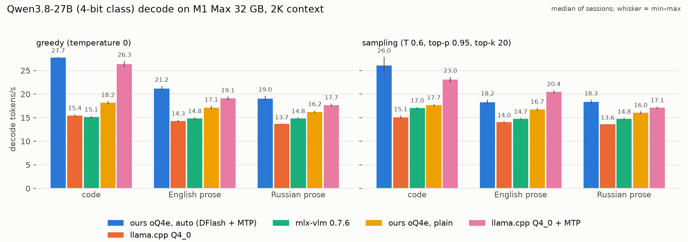

# Qwen3.8-27B decode speed on an M1 Max: this server, llama.cpp, stock mlx-vlm

17.11.2026. One machine: MacBook Pro M1 Max, 32 GB, 32 GPU cores, AC power, `powermode 2`,
`iogpu.wired_limit_mb=27648`. mlx 0.32.3, mlx-vlm 0.7.6, llama.cpp build 12359 (b1b770d90,
Homebrew). Code under test: main `0343abc` (first session of every system) and `3e5a154` (second). Harness: `scripts/perf/bench27/` (`run_matrix.py` → `session.py` →
`bench_decode.py`), plan `headline2`; its smoke run and the checks that every system renders
the prompts to the same tokens are in [../2026-11-16/bench_smoke.md](../2026-11-16/bench_smoke.md).
Labels: [M] measured, [D] derived from measured numbers.

## Systems

All five serve the same model through an OpenAI-compatible HTTP API with streaming, one
request at a time, thinking off.

| system | weights | how it runs |
|---|---|---|
| ours, plain | `qwen38-27b-mlx-oq4e` (mixed 4–8 bit, 16 GB) | worker + gateway, the stand's recipe: `QWEN_TEXT_ONLY=1 QWEN_MRQMM4/5/6=1 QWEN_KV_BITS=8 QWEN_KVQ_PREFILL_FUSED=1 QWEN_DECODE_ATT=8192 QWEN_MAX_BATCH=1` + the 96K memory settings |
| ours, `auto` | + DFlash2 drafter (3.6 GB) and the model's own MTP head (0.3 GB) | + `QWEN_DRAFT=auto`: picks DFlash / the head / neither per round, also under sampling |
| llama.cpp | `Qwen3.8-27B-Q4_0.gguf` (15 GB) | `llama-server -ngl 99 -fa on -c 8192 --jinja -np 1 --cache-ram 0` |
| llama.cpp + MTP | + `mtp-Qwen3.8-27B-Q4_0.gguf` (1.6 GB) | + `--spec-type draft-mtp -md …` (its default draft length) |
| mlx-vlm | `qwen38-27b-mlx-4bit` (uniform 4 bit, 15 GB) | `python -m mlx_vlm.server` (stock 0.7.6) |

The quantizations are not the same file: each system runs the 4-bit-class build its
ecosystem ships (ours the mixed-precision one the stand uses, 1 GB larger than the other
two). Answer quality is not compared here. llama.cpp's DFlash and mlx-vlm's DFlash ran in
the earlier matrix and are left out: slower than llama.cpp + MTP on prose, and mlx-vlm's
is pathologically slow (bench_smoke.md).

## Method

- Plan `headline2`: 9 prompts of 2047–2048 tokens (3 code, 3 English prose, 3 Russian
  prose), each greedy and sampled (T 0.6, top-p 0.95, top-k 20), 256 generated tokens; then
  one 1024-token greedy code answer. 19 cells, the classes interleaved (code, English,
  Russian, code, …).
- One session = one system in fresh processes: preflight (no other model process, nice 0,
  power mode), a 30 s memory-bandwidth probe (334–339 GB/s in every session), start, one
  warm-up request, the 19 cells in the same order, stop. Sessions run back to back under
  one GPU lease, nothing else on the machine.
- Decode tok/s = (completion tokens − tokens of the first chunk) / (last chunk − first
  chunk), timed by the client at the HTTP stream. Every greedy cell is a cold prefill
  (TTFT and prefill tok/s come from it).
- **A session slows down as the machine warms up**: the same system loses 16–23 % between
  its first and its twelfth cell and is nearly flat after that (below). So systems are compared cell
  by cell at the same position of their sessions, and the per-class medians take one cool,
  one middle and one warm cell of every class. Numbers from different positions do not
  compare, and a lone "tok/s" of this machine means little without its minute.

## Results

Decode tok/s: each session's median over the class's three prompts, then the median of the two
sessions [M] (the chart shows the same numbers; whiskers = the two sessions):

| system | code greedy | English greedy | Russian greedy | code sampling | English sampling | Russian sampling | code, 1024 tokens |
|---|---|---|---|---|---|---|---|
| ours, `auto` | 27.7 | 21.2 | 19.0 | 26.0 | 18.2 | 18.3 | 35.8 |
| llama.cpp + MTP | 26.3 | 19.1 | 17.7 | 23.0 | 20.5 | 17.1 | 24.1 |
| ours, plain | 18.2 | 17.1 | 16.2 | 17.7 | 16.7 | 16.0 | 15.7 |
| mlx-vlm | 15.1 | 14.8 | 14.8 | 17.0 | 14.7 | 14.8 | 14.6 |
| llama.cpp | 15.4 | 14.3 | 13.7 | 15.1 | 14.0 | 13.6 | 13.5 |

Ratios cell by cell (the same prompt, mode and position in the session) [D]:

| ratio (geometric mean over cells) | all 19 cells | min – max | cells ≥ 1 | code greedy | en greedy | ru greedy | code sampling | en sampling | ru sampling |
|---|---|---|---|---|---|---|---|---|---|
| ours, `auto` / llama.cpp + MTP | ×1.10 | 0.87 – 1.49 | 17 / 19 | ×1.15 | ×1.05 | ×1.09 | ×1.20 | ×0.96 | ×1.06 |
| ours, plain / llama.cpp | ×1.15 | 1.05 – 1.20 | 19 / 19 | ×1.14 | ×1.15 | ×1.15 | ×1.13 | ×1.14 | ×1.15 |
| ours, plain / mlx-vlm | ×1.08 | 0.93 – 1.20 | 18 / 19 | ×1.09 | ×1.08 | ×1.10 | ×1.04 | ×1.09 | ×1.11 |
| ours, `auto` / llama.cpp | ×1.59 | 1.29 – 2.65 | 19 / 19 | ×1.97 | ×1.47 | ×1.38 | ×1.97 | ×1.30 | ×1.31 |
| ours, `auto` / ours, plain | ×1.38 | 1.09 – 2.51 | 19 / 19 | ×1.73 | ×1.28 | ×1.20 | ×1.75 | ×1.14 | ×1.13 |
| llama.cpp + MTP / llama.cpp | ×1.44 | 1.16 – 1.94 | 19 / 19 | ×1.71 | ×1.39 | ×1.27 | ×1.64 | ×1.35 | ×1.23 |

- **Plain decode**: ×1.15 of llama.cpp, ahead in every one of the 19 cells (×1.05–1.09 cool, ×1.16–1.20
  warm) and ×1.08 of stock mlx-vlm (equal while cool, ×1.07–1.20 warm; one sampled cell 0.93).
- **With speculation**: `auto` is ×1.10 of llama.cpp + MTP over the 19 cells and ahead in
  17; code ×1.15–1.20 (the 1024-token answer ×1.49), Russian ×1.06–1.09, English ×1.05
  greedy and ×0.96 sampled (the two cells behind are sampled English).
- Against plain llama.cpp `auto` is ×1.59 (code ×1.97, English ×1.3–1.5, Russian ×1.3–1.4).
- What speculation adds on top of our own plain decode: code ×1.7, English ×1.28 greedy /
  ×1.14 sampled, Russian ×1.20 / ×1.13 (sessions apart, so ±5 %; in-process A/B per
  drafter: [auto_gate.md](auto_gate.md)).

Every cell, tok/s per session (`a / b` = first / second session of that system) [M]:

| # | cell | ours, `auto` | llama.cpp + MTP | ours, plain | mlx-vlm | llama.cpp |
|---|---|---|---|---|---|---|
| 1 | code-2k-0 greedy | 37.7 / 37.8 | 30.3 / 30.3 | 19.0 / 18.9 | 18.9 / 18.9 | 17.7 / 17.7 |
| 2 | code-2k-0 sample | 46.7 / 46.7 | 31.7 / 31.7 | 18.6 / 18.6 | 18.7 / 18.7 | 17.6 / 17.7 |
| 3 | en-2k-0 greedy | 25.5 / 25.3 | 25.3 / 25.3 | 18.9 / 18.9 | 18.7 / 18.9 | 17.4 / 17.4 |
| 4 | en-2k-0 sample | 22.5 / 22.4 | 23.0 / 23.0 | 18.6 / 18.6 | 18.2 / 16.9 | 17.4 / 17.2 |
| 5 | ru-2k-0 greedy | 23.3 / 23.1 | 21.6 / 21.4 | 18.9 / 18.6 | 16.7 / 16.0 | 17.3 / 16.8 |
| 6 | ru-2k-0 sample | 21.0 / 21.2 | 21.0 / 20.6 | 18.4 / 18.1 | 15.8 / 15.2 | 16.7 / 16.0 |
| 7 | code-2k-1 greedy | 27.9 / 27.6 | 23.5 / 22.9 | 18.5 / 17.9 | 15.4 / 14.8 | 15.7 / 15.2 |
| 8 | code-2k-1 sample | 23.8 / 21.9 | 22.4 / 21.2 | 17.9 / 17.4 | 15.0 / 14.5 | 15.4 / 14.7 |
| 9 | en-2k-1 greedy | 21.4 / 20.7 | 19.5 / 18.4 | 17.5 / 16.8 | 15.1 / 14.5 | 14.5 / 14.1 |
| 10 | en-2k-1 sample | 18.8 / 17.7 | 17.9 / 16.9 | 17.0 / 16.4 | 14.9 / 14.6 | 14.2 / 13.9 |
| 11 | ru-2k-1 greedy | 19.6 / 18.4 | 17.5 / 16.6 | 16.5 / 15.9 | 15.0 / 14.6 | 13.7 / 13.6 |
| 12 | ru-2k-1 sample | 17.8 / 17.2 | 16.2 / 15.4 | 16.3 / 15.7 | 14.9 / 14.6 | 13.7 / 13.5 |
| 13 | code-2k-2 greedy | 27.1 / 26.7 | 27.0 / 25.7 | 16.2 / 15.7 | 15.0 / 14.7 | 13.6 / 13.4 |
| 14 | code-2k-2 sample | 24.2 / 27.9 | 23.6 / 22.5 | 16.1 / 15.7 | 17.3 / 16.7 | 13.7 / 13.4 |
| 15 | en-2k-2 greedy | 21.7 / 18.4 | 19.4 / 18.7 | 16.1 / 15.7 | 14.9 / 14.5 | 13.7 / 13.5 |
| 16 | en-2k-2 sample | 17.8 / 17.7 | 20.8 / 20.1 | 15.9 / 15.6 | 14.9 / 14.5 | 13.7 / 13.5 |
| 17 | ru-2k-2 greedy | 19.2 / 18.2 | 17.9 / 17.4 | 15.9 / 15.6 | 14.9 / 14.6 | 13.7 / 13.5 |
| 18 | ru-2k-2 sample | 17.6 / 18.8 | 17.4 / 16.8 | 15.9 / 15.6 | 14.8 / 14.5 | 13.7 / 13.4 |
| 19 | code-2k-0 greedy 1024 | 36.2 / 35.4 | 24.4 / 23.7 | 15.9 / 15.6 | 14.7 / 14.5 | 13.7 / 13.3 |

### The warm-up inside a session

Plain decode by position, first sessions (cells 1, 7, 13, 19 are the code class) [M]: ours 19.0 →
18.5 → 16.2 → 15.9, llama.cpp 17.7 → 15.7 → 13.6 → 13.7, mlx-vlm 18.9 → 15.4 → 15.0 → 14.7.
The drop arrives after 2–4 minutes of load and is not in the memory-bandwidth probe (the
same before every session); two sessions of llama.cpp + MTP repeat each other within 0–6 %
cell by cell. Our plain decode loses 16 %, mlx-vlm 22 %, llama.cpp 23 %.

### Cold prefill at 2K

TTFT of the greedy cells = a cold 2K prefill [M]: ours 12.6–15.8 s (162 → 130 tok/s over
the session), llama.cpp 13.6–17.4 s (150 → 118 tok/s), mlx-vlm 18.3–22.5 s (112 → 91 tok/s):
×1.08–1.10 of llama.cpp and ×1.43–1.45 of mlx-vlm at the same position [D].

## Long context (8K, 32K)

Plan `ctx`: code and Russian prompts of 8K and 32K tokens, greedy, 256 tokens, two rounds,
then a follow-up turn on the 32K conversation. Ours: `auto` on q8 KV, today (main
`3e5a154`); llama.cpp and mlx-vlm: the same plan and cell order on 2026-11-16 — another
day, so indicative, and only the first round is at a matching position (in ours the second
round is a prompt-cache hit, in theirs a second cold prefill, so the machine is warmer). [M]

| decode tok/s, round 1 / round 2 | ours, `auto` | llama.cpp + MTP | llama.cpp | mlx-vlm |
|---|---|---|---|---|
| code 8K | 35.3 / 30.5 | 29.5 / 20.1 | 16.1 / 11.9 | 15.6 / 11.4 |
| Russian 8K | 22.7 / 19.2 | 16.1 / 13.8 | 13.6 / 11.6 | 12.4 / 11.2 |
| code 32K | 29.4 / 29.3 | 16.3 / 16.7 | 10.8 / 10.7 | 10.3 / 9.8 |
| Russian 32K | 16.3 / 17.4 | 11.6 / 11.8 | 10.6 / 10.8 | 10.2 / 10.0 |

| cold prefill (TTFT, round 1) | ours | llama.cpp + MTP | llama.cpp | mlx-vlm |
|---|---|---|---|---|
| 8K (code / Russian) | 51 s / 53 s | 59 s / 66 s | 57 s / 64 s | 79 s / 93 s |
| 32K (code / Russian) | 280 s / 288 s | 368 s / 366 s | 346 s / 352 s | 454 s / 456 s |
| follow-up turn on the 32K conversation | 4.5 s, then 1.2 s | 1.0 s | 0.9 s | 459 s (no cache) |

- In the first round `auto` is ×1.2 (code 8K), ×1.4 (Russian) and ×1.8 (code 32K) of
  llama.cpp + MTP [D]; its decode loses 17 % from 8K to 32K on code where llama.cpp + MTP
  loses 45 %.
- Russian at long context is where one drafter is not enough: with DFlash alone this
  server read 8.9 tok/s at 8K and 6.8 at 32K on 2026-11-16 (below llama.cpp's plain decode);
  `auto` takes the MTP head there (118–136 of ~135 rounds) and reads 16–23.
- A cold 32K prefill is ×1.2–1.3 of llama.cpp and ×1.6 of mlx-vlm; the first follow-up
  turn is slower than llama.cpp's (4.5 s against 1.0 s; the second 1.2 s).

## Limits of this comparison

- One machine, one day; two sessions per system (the second on a later commit of the
  chooser: `auto` differs in three cells by 9–15 % either way, the rest within the repeat
  noise).
- llama.cpp's `draft-mtp` ran with its default draft length; it was not tuned per class.
- Different quantization files (above): speed per system as its ecosystem ships the model,
  not kernel against kernel on identical weights.
- Long context: one session per system, the external ones on another day; 80K not re-run
  for `auto`.
- Peak memory is not in the table: the harness reads the process footprint, which does not
  count llama.cpp's Metal buffers.

Raw: `raw/bench27/<session>.json` (every request: tokens, TTFT, chunk arrival times, the
worker's per-request drafter lines), `raw/bench27/index-*.json`. Charts:
`decode_2k_light.png` / `decode_2k_dark.png`.
