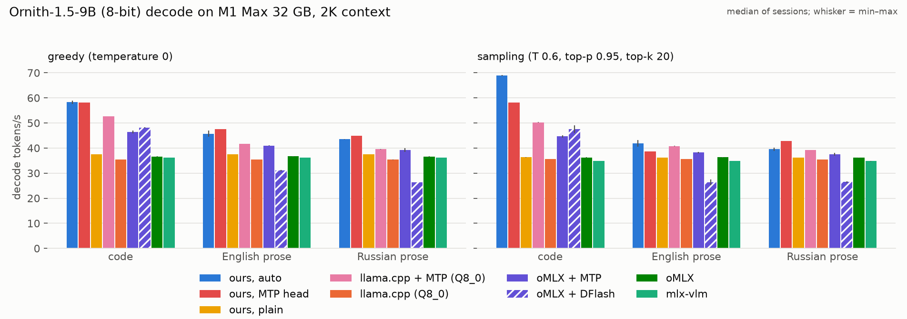

# Ornith-1.5-9B decode speed on an M1 Max: this server, llama.cpp, oMLX, stock mlx-vlm

18.11.2026. One machine: MacBook Pro M1 Max, 32 GB, 32 GPU cores, AC power, `powermode 2`,
`iogpu.wired_limit_mb=27648`. mlx 0.32.3, mlx-vlm 0.7.6, llama.cpp build 12359 (b1b770d90,
Homebrew), oMLX 0.8.0rc1 (its release wheel, with its own mlx 0.32.4, mlx-lm 0.32.3.dev8, mlx-vlm
0.7.11). Code under test: main `2df454b` (every session; the table under "Sessions"). Harness:
`scripts/perf/bench27/` (`run_matrix.py` → `session.py` → `bench_decode.py`), plan `headline2`,
the same prompts and cell order as the 27B run of
[../2026-11-17/decode_27b_bench.md](../2026-11-17/decode_27b_bench.md). Tables:
`scripts/perf/bench27/report.py` (commands at the end). Labels: [M] measured, [D] derived from
measured numbers.

Findings first:

- Plain decode is a tie within 4 %: ours ×1.04 of llama.cpp and of mlx-vlm, ×1.01 of oMLX, in
  every cell [D]. On this 8-bit model one decode step reads the whole 9 GB of weights, and every
  system gets close to the same bandwidth.
- With speculation `auto` is ×1.13 of llama.cpp + MTP over the 19 cells and ahead in 18; it
  loses one sampled Russian cell (0.92), and on sampled prose it is only ×1.01–1.06 [D].
- `auto` is not the fastest of our own settings on prose: the MTP head alone is 3–5 % faster on
  greedy prose and Russian sampling (sessions apart, ±5 %; in-process: [auto_gate_9b.md](auto_gate_9b.md)).
- A prompt-cache hit answers in 0.11 s (plain) and 0.28 s (`auto`, median) against llama.cpp's
  0.04 s [M]; cold 2K prefill is ×1.09–1.11 of llama.cpp and ×1.44 of mlx-vlm [D].
- At long context `auto` keeps its lead on code (×1.37 of llama.cpp + MTP at 32K, ×1.93 at
  80K), but on Russian at 32K it is no faster than our plain decode (×0.99) [D].

## Systems

All nine serve the same model through an OpenAI-compatible HTTP API with streaming, one
request at a time, thinking off.

| system | weights | how it runs |
|---|---|---|
| ours, plain | `ornith15-9b-mlx-8bit` (MLX, 8 bit) | worker + gateway: `QWEN_KV_BITS=0` (fp16 KV) `QWEN_MAX_BATCH=1`, prompt cache 4 GB without reply KV (`session.py` `OURS9_ENV`) |
| ours, `auto` | + a DFlash drafter trained for Ornith 1.5 and the model's own MTP head, 8-bit | + `QWEN_DRAFT=auto` with `QWEN_DRAFT_DFLASH` / `QWEN_DRAFT_MTP` naming the two (below): picks DFlash / the head / neither per round, also under sampling |
| ours, MTP head | + the MTP head only | + `QWEN_DRAFT=<head dir>` `QWEN_MTP_K=0` (the head's own depth rule) `QWEN_DRAFT_SAMPLING=1` |
| llama.cpp | `Ornith-1.5-9B-MTP-Q8_0.gguf` (the MTP layers inside) | `llama-server -ngl 99 -fa on -c 8192 --jinja -np 1 --cache-ram 0` (`-c 36864` / `86016` for the long-context plans) |
| llama.cpp + MTP | the same file | + `--spec-type draft-mtp` (the file's own MTP layers, no `-md`; its default draft length) |
| oMLX | `ornith15-9b-mlx-8bit`, the same files as ours | `omlx serve --headless --max-concurrent-requests 1`, fp16 activations **on** (its default is off), prefix cache in RAM only (hot cache 4 GB, no SSD tier), its defaults otherwise (burst decode `balanced`, GPU keep-warm 0.5 s) |
| oMLX + MTP | the same files + the same 8-bit head weights, assembled into the model dir oMLX expects (`omlx_mtp_dir.py`) | + its MTP ("Lightning MTP", adaptive depth, its default ceiling) |
| oMLX + DFlash | + the same DFlash drafter | + its DFlash (its default: block 9, adaptive; it runs inside oMLX's MTP batch generator, per its log) |
| mlx-vlm | `ornith15-9b-mlx-8bit`, the same files as ours | `python -m mlx_vlm.server` (stock 0.7.6) |

Ours, oMLX and mlx-vlm load the same files; llama.cpp runs Q8_0, the GGUF of the same precision
(not the same bytes). Answer quality is not compared here. Our drafters were named explicitly
from a staging dir (`weights/_staging/ornith15-9b-dflash`, `weights/_staging/ornith15-9b-mtp-q8`):
`QWEN_DRAFT=auto` on its own looks for drafters next to the model dir, and they were not there.
The head is the one split from the original checkpoint and quantized to 8 bits (the head
comparison in [auto_gate_9b.md](auto_gate_9b.md)). oMLX ran with its fp16-activation option
switched on, so that activations and KV are fp16 as in ours (M1 has no fast bf16); it served the
model through its text engine on mlx-lm (`engine: batched`, the log in each oMLX session). A
DFlash system of ours alone was not in the matrix (its in-process numbers are in the gate report).

## Method

- Plan `headline2`: 9 prompts of about 2K tokens (3 code, 3 English prose, 3 Russian prose),
  each greedy and sampled (T 0.6, top-p 0.95, top-k 20), 256 generated tokens; then one
  1024-token greedy code answer. 19 cells, the classes interleaved (code, English, Russian,
  code, …). The prompts were cut to 2047–2048 tokens of the 27B's tokenizer; all nine systems
  count the 9B's tokens the same, equal to the manifest (below).
- One session = one system in fresh processes: preflight (no other model process, nice 0,
  power mode), a 30 s memory-bandwidth probe (335.5–338.0 GB/s in every session in the tables),
  start, one warm-up request, the 19 cells in the same order, stop. Sessions run back to back
  under one GPU lease, nothing else on the machine.
- Passes: `h2b` (10:41–11:07, five systems), `h2c` (15:24–16:12, all nine) and the oMLX pass
  (10:19–10:41, the three oMLX systems and the head alone). Two sessions per system count: `h2b`
  + `h2c`, the oMLX systems the oMLX pass + `h2c`. The head alone counts with its `h2c` session
  only: in the oMLX pass its sampled cells ran plain decode (`QWEN_DRAFT_SAMPLING` was not set
  for that system), so that session is left out (`--exclude`); its raw data is kept.
- **The night pass `h2a` (01:44–02:16, five systems) is left out of every table** and kept in
  the raw data. Every system ran slower in it than in the day passes: cell by cell ×0.76–0.87
  of the same system's day sessions (worst cells 0.61–0.72), with probes of 322–330 GB/s against
  335–338 by day [D, `raw/bench9_passes.md`]; and a CPU-heavy test job of this project ran
  beside it for about two minutes, against the bench's own rule of nothing else on the machine.
  The two day passes repeat each other: the plain systems within 0–2 % cell by cell, the
  speculating ones within 0–2 % on average (single cells 0.80–1.17; the head's ×1.11 there is against the
  left-out session) [D, same file].
- Decode tok/s = (completion tokens − tokens of the first chunk) / (last chunk − first
  chunk), timed by the client at the HTTP stream. Every greedy cell is a cold prefill
  (TTFT and prefill tok/s come from it); the sampled cell after it repeats the prompt, a
  prompt-cache hit where the server has one.
- Unlike the 27B, the 9B's plain decode does not slow down inside a session (below), but
  systems are still compared cell by cell at the same position of their sessions, and the
  per-class medians take one cool, one middle and one warm cell of every class.

## Results

Decode tok/s: each session's median over the class's three prompts, then the median of the two
sessions [M] (the chart shows the same numbers; whiskers = the two sessions):



<!-- report.py medians -->
| system | code greedy | English greedy | Russian greedy | code sampling | English sampling | Russian sampling | code, 1024 tokens |
|---|---|---|---|---|---|---|---|
| ours, `auto` | 58.3 | 45.7 | 43.5 | 68.9 | 41.9 | 39.5 | 77.1 |
| llama.cpp + MTP | 52.7 | 41.7 | 39.5 | 50.3 | 40.8 | 39.3 | 51.6 |
| oMLX + MTP | 46.5 | 41.0 | 39.1 | 44.6 | 38.2 | 37.5 | 43.6 |
| ours, plain | 37.5 | 37.5 | 37.5 | 36.3 | 36.3 | 36.3 | 37.2 |
| mlx-vlm | 36.2 | 36.2 | 36.2 | 34.8 | 34.8 | 34.8 | 36.0 |
| llama.cpp | 35.4 | 35.4 | 35.3 | 35.6 | 35.5 | 35.5 | 34.1 |
| oMLX | 36.6 | 36.7 | 36.6 | 36.3 | 36.3 | 36.1 | 36.4 |
| ours, MTP head | 58.1 | 47.6 | 45.0 | 58.2 | 38.7 | 42.8 | 56.3 |
| oMLX + DFlash | 48.1 | 31.0 | 26.4 | 47.6 | 26.4 | 26.5 | 57.9 |
<!-- /report.py medians -->

Ratios cell by cell (the same prompt, mode and position in the session) [D]:

<!-- report.py ratios -->
| ratio (geometric mean over cells) | all 19 cells | min – max | cells ≥ 1 | code greedy | English greedy | Russian greedy | code sampling | English sampling | Russian sampling |
|---|---|---|---|---|---|---|---|---|---|
| ours, `auto` / llama.cpp + MTP | ×1.13 | 0.92 – 1.50 | 18 / 19 | ×1.12 | ×1.12 | ×1.10 | ×1.30 | ×1.06 | ×1.01 |
| ours, plain / llama.cpp | ×1.04 | 1.02 – 1.09 | 19 / 19 | ×1.06 | ×1.06 | ×1.06 | ×1.02 | ×1.02 | ×1.03 |
| ours, plain / mlx-vlm | ×1.04 | 1.03 – 1.04 | 19 / 19 | ×1.03 | ×1.03 | ×1.03 | ×1.04 | ×1.04 | ×1.04 |
| ours, `auto` / llama.cpp | ×1.39 | 1.07 – 2.26 | 19 / 19 | ×1.62 | ×1.28 | ×1.26 | ×1.80 | ×1.18 | ×1.11 |
| ours, `auto` / ours, plain | ×1.33 | 1.05 – 2.07 | 19 / 19 | ×1.53 | ×1.21 | ×1.18 | ×1.76 | ×1.15 | ×1.09 |
| llama.cpp + MTP / llama.cpp | ×1.23 | 0.95 – 1.66 | 18 / 19 | ×1.45 | ×1.14 | ×1.14 | ×1.38 | ×1.11 | ×1.10 |
| ours, `auto` / oMLX + MTP | ×1.19 | 0.98 – 1.77 | 18 / 19 | ×1.27 | ×1.12 | ×1.11 | ×1.40 | ×1.10 | ×1.02 |
| ours, plain / oMLX | ×1.01 | 1.00 – 1.03 | 19 / 19 | ×1.02 | ×1.02 | ×1.02 | ×1.00 | ×1.00 | ×1.00 |
| ours, MTP head / oMLX + MTP | ×1.17 | 1.00 – 1.37 | 19 / 19 | ×1.29 | ×1.15 | ×1.17 | ×1.25 | ×1.05 | ×1.06 |
| oMLX + MTP / oMLX | ×1.14 | 1.01 – 1.32 | 19 / 19 | ×1.24 | ×1.11 | ×1.09 | ×1.26 | ×1.05 | ×1.07 |
| ours, `auto` / ours, MTP head | ×1.02 | 0.89 – 1.37 | 8 / 19 | ×0.99 | ×0.97 | ×0.95 | ×1.12 | ×1.05 | ×0.96 |
| ours, MTP head / llama.cpp + MTP | ×1.11 | 0.95 – 1.22 | 17 / 19 | ×1.13 | ×1.16 | ×1.16 | ×1.16 | ×1.01 | ×1.06 |
<!-- /report.py ratios -->

- **Plain decode**: ours ×1.04 of llama.cpp (1.02–1.09, ahead in 19 of 19 cells), ×1.04 of
  mlx-vlm (1.03–1.04) and ×1.01 of oMLX (1.00–1.03). The four plain decoders are within 4 % of
  each other: a tie, not a lead.
- **With speculation**: `auto` is ×1.13 of llama.cpp + MTP over the 19 cells, ahead in 18:
  code ×1.12 greedy / ×1.30 sampled (the 1024-token code answer 77.1 against 51.6 tok/s), English
  ×1.12 / ×1.06, Russian ×1.10 / ×1.01. The cell behind is sampled Russian (cell 18, ×0.92); on
  sampled prose `auto` is only slightly ahead (×1.06 English, ×1.01 Russian), inside the ±5 % that
  separate sessions allow.
- Against plain llama.cpp `auto` is ×1.39 (code ×1.62 / ×1.80, English ×1.28 / ×1.18, Russian
  ×1.26 / ×1.11); llama.cpp's own MTP gives it ×1.23 (one cell below its plain decode).
- Against oMLX: `auto` ×1.19 of oMLX + MTP (ahead in 18 of 19); the head alone ×1.17 of oMLX's
  MTP with the same head weights (19 of 19; code ×1.25–1.29, prose ×1.05–1.17); oMLX's MTP gives
  it ×1.14 over its plain decode. oMLX + DFlash runs code at 47.6–48.1 tok/s but prose at
  26.4–31.0, below its own plain decode (36.1–36.7), as our DFlash alone does on prose.
- What speculation adds on top of our own plain decode: code ×1.53 greedy / ×1.76 sampled,
  English ×1.21 / ×1.15, Russian ×1.18 / ×1.09 (sessions apart, so ±5 %).
- **`auto` against the head alone** (one session of the head, so ±5 %): ×1.02 over the 19
  cells but ahead in only 8; greedy prose ×0.95–0.97 and sampled Russian ×0.96 behind the head,
  sampled code ×1.12 ahead. On prose the head is the better setting today; the in-process
  numbers and where the time goes: [auto_gate_9b.md](auto_gate_9b.md).

Every cell, tok/s per session (`a / b` = first / second session of that system; the head alone
has one) [M]:

<!-- report.py cells -->
| # | cell | ours, `auto` | llama.cpp + MTP | oMLX + MTP | ours, plain | mlx-vlm | llama.cpp | oMLX | ours, MTP head | oMLX + DFlash |
|---|---|---|---|---|---|---|---|---|---|---|
| 1 | code-2k-0 greedy | 58.9 / 64.3 | 58.8 / 58.8 | 47.3 / 47.0 | 37.4 / 37.4 | 36.2 / 36.2 | 35.4 / 35.4 | 36.7 / 36.7 | 63.6 | 52.8 / 52.8 |
| 2 | code-2k-0 sample | 68.9 / 70.1 | 54.6 / 54.5 | 46.9 / 44.2 | 36.3 / 36.3 | 34.8 / 34.8 | 35.7 / 35.7 | 36.3 / 36.4 | 62.3 | 46.1 / 49.2 |
| 3 | en-2k-0 greedy | 45.6 / 46.9 | 41.7 / 41.7 | 40.8 / 41.1 | 37.5 / 37.5 | 36.3 / 36.3 | 35.5 / 35.5 | 36.8 / 36.8 | 48.8 | 30.8 / 31.3 |
| 4 | en-2k-0 sample | 47.8 / 43.3 | 44.4 / 44.4 | 37.4 / 38.4 | 36.3 / 36.3 | 34.8 / 34.8 | 35.7 / 35.7 | 36.3 / 36.4 | 42.4 | 24.1 / 28.3 |
| 5 | ru-2k-0 greedy | 46.4 / 46.7 | 43.9 / 43.9 | 44.2 / 40.9 | 37.5 / 37.5 | 36.2 / 36.2 | 35.4 / 35.5 | 36.6 / 36.8 | 50.2 | 26.4 / 26.3 |
| 6 | ru-2k-0 sample | 42.0 / 42.2 | 39.3 / 39.3 | 40.8 / 44.9 | 36.3 / 36.3 | 34.8 / 34.8 | 35.7 / 35.6 | 35.9 / 36.2 | 44.4 | 21.7 / 22.0 |
| 7 | code-2k-1 greedy | 59.2 / 57.6 | 52.6 / 52.7 | 45.9 / 47.0 | 37.5 / 37.5 | 36.2 / 36.3 | 35.4 / 35.4 | 36.2 / 36.7 | 58.1 | 48.4 / 47.8 |
| 8 | code-2k-1 sample | 68.7 / 69.1 | 50.2 / 50.3 | 45.0 / 49.9 | 36.3 / 36.3 | 34.8 / 34.9 | 35.6 / 35.6 | 35.7 / 36.3 | 58.2 | 49.3 / 50.1 |
| 9 | en-2k-1 greedy | 44.0 / 43.3 | 37.7 / 37.7 | 38.1 / 40.6 | 37.5 / 37.4 | 36.2 / 36.2 | 35.4 / 35.4 | 36.1 / 36.7 | 44.5 | 29.2 / 29.1 |
| 10 | en-2k-1 sample | 35.6 / 40.8 | 33.7 / 33.7 | 38.5 / 36.7 | 36.3 / 36.2 | 34.8 / 34.8 | 35.5 / 35.5 | 35.7 / 36.4 | 38.5 | 25.2 / 25.5 |
| 11 | ru-2k-1 greedy | 43.3 / 43.1 | 37.6 / 37.5 | 38.0 / 37.6 | 37.4 / 37.3 | 36.2 / 36.2 | 35.3 / 35.4 | 36.2 / 36.7 | 44.9 | 22.2 / 22.6 |
| 12 | ru-2k-1 sample | 40.2 / 35.6 | 36.1 / 36.1 | 38.0 / 35.2 | 36.3 / 36.2 | 34.7 / 34.9 | 35.5 / 35.5 | 36.0 / 36.3 | 36.7 | 26.2 / 26.8 |
| 13 | code-2k-2 greedy | 52.5 / 52.5 | 43.6 / 44.1 | 42.5 / 41.9 | 37.5 / 37.4 | 36.2 / 36.2 | 35.3 / 35.3 | 36.6 / 36.7 | 53.3 | 40.8 / 40.7 |
| 14 | code-2k-2 sample | 51.3 / 58.1 | 43.3 / 43.6 | 44.8 / 43.5 | 36.3 / 36.3 | 34.8 / 34.8 | 35.4 / 35.5 | 36.2 / 36.4 | 51.5 | 37.9 / 30.3 |
| 15 | en-2k-2 greedy | 44.5 / 48.1 | 41.8 / 42.0 | 41.5 / 42.3 | 37.5 / 37.5 | 36.1 / 36.2 | 35.2 / 35.2 | 36.6 / 36.8 | 47.6 | 32.5 / 32.4 |
| 16 | en-2k-2 sample | 40.6 / 43.4 | 40.8 / 40.8 | 38.8 / 38.0 | 36.2 / 36.3 | 34.8 / 34.8 | 35.3 / 35.2 | 36.3 / 36.4 | 38.7 | 27.2 / 27.6 |
| 17 | ru-2k-2 greedy | 43.0 / 43.7 | 39.4 / 39.6 | 39.9 / 38.4 | 37.5 / 37.5 | 36.2 / 36.2 | 34.7 / 34.9 | 36.5 / 36.7 | 45.0 | 30.4 / 29.9 |
| 18 | ru-2k-2 sample | 37.5 / 38.9 | 41.6 / 41.7 | 37.0 / 36.9 | 36.3 / 36.3 | 34.7 / 34.8 | 34.9 / 34.9 | 36.0 / 36.3 | 42.8 | 28.6 / 28.7 |
| 19 | code-2k-0 greedy 1024 | 77.1 / 77.1 | 51.5 / 51.6 | 44.8 / 42.5 | 37.2 / 37.3 | 36.0 / 36.0 | 34.0 / 34.3 | 36.1 / 36.7 | 56.3 | 57.8 / 58.1 |
<!-- /report.py cells -->

### The warm-up inside a session

Greedy code cells by position, every session [M] (for the speculating systems the prompts differ
in how well they draft and cell 19 is a 1024-token answer, so their columns are not a warm-up
measure):

<!-- report.py warmup -->
| system | session | cell 1 (code-2k-0) | cell 7 (code-2k-1) | cell 13 (code-2k-2) | cell 19 (code-2k-0, 1024) | first → last |
|---|---|---|---|---|---|---|
| ours, `auto` | a | 58.9 | 59.2 | 52.5 | 77.1 | +31 % |
| ours, `auto` | b | 64.3 | 57.6 | 52.5 | 77.1 | +20 % |
| llama.cpp + MTP | a | 58.8 | 52.6 | 43.6 | 51.5 | −12 % |
| llama.cpp + MTP | b | 58.8 | 52.7 | 44.1 | 51.6 | −12 % |
| oMLX + MTP | a | 47.3 | 45.9 | 42.5 | 44.8 | −5 % |
| oMLX + MTP | b | 47.0 | 47.0 | 41.9 | 42.5 | −10 % |
| ours, plain | a | 37.4 | 37.5 | 37.5 | 37.2 | 0 % |
| ours, plain | b | 37.4 | 37.5 | 37.4 | 37.3 | 0 % |
| mlx-vlm | a | 36.2 | 36.2 | 36.2 | 36.0 | 0 % |
| mlx-vlm | b | 36.2 | 36.3 | 36.2 | 36.0 | −1 % |
| llama.cpp | a | 35.4 | 35.4 | 35.3 | 34.0 | −4 % |
| llama.cpp | b | 35.4 | 35.4 | 35.3 | 34.3 | −3 % |
| oMLX | a | 36.7 | 36.2 | 36.6 | 36.1 | −1 % |
| oMLX | b | 36.7 | 36.7 | 36.7 | 36.7 | 0 % |
| ours, MTP head | a | 63.6 | 58.1 | 53.3 | 56.3 | −11 % |
| oMLX + DFlash | a | 52.8 | 48.4 | 40.8 | 57.8 | +10 % |
| oMLX + DFlash | b | 52.8 | 47.8 | 40.7 | 58.1 | +10 % |
<!-- /report.py warmup -->

The 9B's plain decode is flat over a session: ours and mlx-vlm 0–1 % from the first to the last
code cell, oMLX 0–1 %, llama.cpp 3–4 % (all of it in the 1024-token cell). The 27B lost 16–23 %
over the same plan; the 9B reads half the bytes per step. Two sessions of the same system repeat
each other within 0–2 % cell by cell for every plain system [D, `raw/bench9_passes.md`].

### Cold prefill at 2K

TTFT of the greedy cells = a cold 2K prefill [M]; the ratio = TTFT of the other system / ours
over the same cells at the same position, geometric mean [D]:

<!-- report.py prefill -->
| system | session | cold greedy cells | TTFT s, min – max | prefill tok/s, first → last cold cell |
|---|---|---|---|---|
| ours, `auto` | a | 9 | 3.7 – 4.0 | 551 → 522 |
| ours, `auto` | b | 9 | 3.7 – 3.9 | 553 → 523 |
| llama.cpp + MTP | a | 10 | 4.1 – 4.6 | 503 → 446 |
| llama.cpp + MTP | b | 10 | 4.1 – 4.6 | 503 → 446 |
| oMLX + MTP | a | 9 | 3.9 – 4.3 | 522 → 473 |
| oMLX + MTP | b | 9 | 3.9 – 4.7 | 521 → 472 |
| ours, plain | a | 9 | 3.5 – 3.8 | 580 → 539 |
| ours, plain | b | 9 | 3.5 – 3.9 | 580 → 574 |
| mlx-vlm | a | 10 | 5.2 – 5.3 | 396 → 395 |
| mlx-vlm | b | 10 | 5.2 – 5.4 | 397 → 396 |
| llama.cpp | a | 10 | 3.8 – 4.4 | 533 → 467 |
| llama.cpp | b | 10 | 3.8 – 4.4 | 533 → 470 |
| oMLX | a | 9 | 3.7 – 4.7 | 550 → 507 |
| oMLX | b | 9 | 3.8 – 4.3 | 544 → 472 |
| ours, MTP head | a | 9 | 3.7 – 4.2 | 551 → 511 |
| oMLX + DFlash | a | 9 | 4.0 – 4.5 | 508 → 496 |
| oMLX + DFlash | b | 9 | 4.0 – 4.5 | 509 → 499 |

| cold prefill speed (TTFT ratio, geometric mean, same cells and position) | session a / b |
|---|---|
| ours, plain / llama.cpp | ×1.09 (9 cells) / ×1.11 (9 cells) |
| ours, plain / mlx-vlm | ×1.44 (9 cells) / ×1.44 (9 cells) |
| ours, `auto` / llama.cpp + MTP | ×1.10 (9 cells) / ×1.10 (9 cells) |
| ours, plain / oMLX | ×1.19 (9 cells) / ×1.11 (9 cells) |
| ours, plain / ours, `auto` | ×1.07 (9 cells) / ×1.06 (9 cells) |
<!-- /report.py prefill -->

Our plain cold 2K prefill is ×1.09–1.11 of llama.cpp, ×1.11–1.19 of oMLX and ×1.44 of mlx-vlm.
`auto` pays 6–7 % on it over plain (the drafters' work over the prompt; a branch that defers it
is in the gate report, "Open").

### Prompt-cache hits

TTFT of the cells that hit the server's prompt cache [M]:

<!-- report.py hits -->
| system | session | cells that hit the prompt cache | TTFT s, min – median – max |
|---|---|---|---|
| ours, `auto` | a | 10 | 0.27 – 0.28 – 0.35 |
| ours, `auto` | b | 10 | 0.28 – 0.28 – 0.42 |
| llama.cpp + MTP | a | 9 | 0.04 – 0.04 – 0.04 |
| llama.cpp + MTP | b | 9 | 0.04 – 0.04 – 0.05 |
| oMLX + MTP | a | 7 | 0.23 – 0.25 – 0.36 |
| oMLX + MTP | b | 7 | 0.24 – 0.26 – 0.37 |
| ours, plain | a | 10 | 0.09 – 0.11 – 0.19 |
| ours, plain | b | 10 | 0.10 – 0.11 – 0.19 |
| mlx-vlm | a | 0 | – (no prompt cache) |
| mlx-vlm | b | 0 | – (no prompt cache) |
| llama.cpp | a | 9 | 0.04 – 0.04 – 0.05 |
| llama.cpp | b | 9 | 0.04 – 0.04 – 0.05 |
| oMLX | a | 7 | 0.21 – 0.24 – 0.36 |
| oMLX | b | 7 | 0.23 – 0.24 – 0.34 |
| ours, MTP head | a | 10 | 0.16 – 0.17 – 0.21 |
| oMLX + DFlash | a | 7 | 0.28 – 0.30 – 0.36 |
| oMLX + DFlash | b | 7 | 0.29 – 0.31 – 0.38 |
<!-- /report.py hits -->

llama.cpp answers a repeated 2K prompt in 0.04 s; ours in 0.11 s plain and 0.28 s under `auto`
(medians; the head alone 0.17 s), oMLX in 0.24–0.31 s. Here we lose: ×2.8–7 of llama.cpp's
time [D]. What `auto` adds over plain on a hit is the drafters' work over the prompt's uncached
tail, done before the first token. On a branch that defers it behind the first token, a hit under
`auto` went from 1.36–1.41 × plain to 0.97–1.01 × plain, in a separate A/B with reply KV on, so
not these numbers ([auto_gate_9b.md](auto_gate_9b.md), "Open"). mlx-vlm has no prompt cache.

### Prompt tokens

`usage.prompt_tokens` of every cell as each server counted it, against the manifest's count
(the 27B tokenizer) [M]:

<!-- report.py tokens -->
| prompt | manifest | ours, `auto` | llama.cpp + MTP | oMLX + MTP | ours, plain | mlx-vlm | llama.cpp | oMLX | ours, MTP head | oMLX + DFlash | systems agree |
|---|---|---|---|---|---|---|---|---|---|---|---|
| code-2k-0 | 2047 | 2047 | 2047 | 2047 | 2047 | 2047 | 2047 | 2047 | 2047 | 2047 | yes |
| en-2k-0 | 2048 | 2048 | 2048 | 2048 | 2048 | 2048 | 2048 | 2048 | 2048 | 2048 | yes |
| ru-2k-0 | 2047 | 2047 | 2047 | 2047 | 2047 | 2047 | 2047 | 2047 | 2047 | 2047 | yes |
| code-2k-1 | 2047 | 2047 | 2047 | 2047 | 2047 | 2047 | 2047 | 2047 | 2047 | 2047 | yes |
| en-2k-1 | 2048 | 2048 | 2048 | 2048 | 2048 | 2048 | 2048 | 2048 | 2048 | 2048 | yes |
| ru-2k-1 | 2048 | 2048 | 2048 | 2048 | 2048 | 2048 | 2048 | 2048 | 2048 | 2048 | yes |
| code-2k-2 | 2048 | 2048 | 2048 | 2048 | 2048 | 2048 | 2048 | 2048 | 2048 | 2048 | yes |
| en-2k-2 | 2048 | 2048 | 2048 | 2048 | 2048 | 2048 | 2048 | 2048 | 2048 | 2048 | yes |
| ru-2k-2 | 2048 | 2048 | 2048 | 2048 | 2048 | 2048 | 2048 | 2048 | 2048 | 2048 | yes |
| code-8k-0 | 8192 | 8192 | 8192 | – | 8192 | 8192 | 8192 | – | – | – | yes |
| ru-8k-0 | 8191 | 8191 | 8191 | – | 8191 | 8191 | 8191 | – | – | – | yes |
| code-32k-0 | 32768 | 32768 | 32768 | – | 32768 | 32768 | 32768 | – | – | – | yes |
| ru-32k-0 | 32768 | 32768 | 32768 | – | 32768 | 32768 | 32768 | – | – | – | yes |
| code-80k-0 | 81919 | 81919 | 81919 | – | 81919 | – | – | – | – | – | yes |
<!-- /report.py tokens -->

## Long context (8K, 32K, 80K)

Plan `ctx`: code and Russian prompts of 8K and 32K tokens, greedy, 256 tokens, two rounds,
then a follow-up turn on the 32K conversation; plan `ctx80`: one 80K code prompt, two rounds
and a follow-up turn (ours `auto`, ours plain and llama.cpp + MTP only). One session per system
and plan, the same day (12:42–13:52). Only the first round is at a matching position (in ours
the second round is a prompt-cache hit, in llama.cpp's and mlx-vlm's a second cold prefill, so
the machine is warmer). oMLX did not run these plans. [M]

<!-- report.py ctx-decode -->
| decode tok/s, round 1 / round 2 | ours, `auto` | llama.cpp + MTP | ours, plain | mlx-vlm | llama.cpp |
|---|---|---|---|---|---|
| code 8K | 64.1 / 55.4 | 49.9 / 43.9 | 36.4 / 35.7 | 34.9 / 32.3 | 34.3 / 31.5 |
| Russian 8K | 46.3 / 35.9 | 34.9 / 30.0 | 36.5 / 35.4 | 35.0 / 32.1 | 34.2 / 31.0 |
| code 32K | 58.1 / 46.1 | 42.2 / 36.5 | 32.8 / 32.0 | 30.8 / 29.0 | 30.7 / 27.4 |
| Russian 32K | 31.6 / 33.5 | 26.9 / 26.2 | 31.9 / 31.8 | 28.9 / 28.3 | 29.0 / 27.3 |
| code 80K | 54.4 / 61.3 | 28.2 / 28.2 | 28.1 / 28.4 | – | – |
<!-- /report.py ctx-decode -->

<!-- report.py ctx-ratios -->
| decode ratio, round 1 (first session) | code 8K | Russian 8K | code 32K | Russian 32K | code 80K |
|---|---|---|---|---|---|
| ours, `auto` / llama.cpp + MTP | ×1.28 | ×1.33 | ×1.37 | ×1.17 | ×1.93 |
| ours, plain / llama.cpp | ×1.06 | ×1.07 | ×1.07 | ×1.10 | – |
| ours, plain / mlx-vlm | ×1.04 | ×1.04 | ×1.07 | ×1.10 | – |
| ours, `auto` / llama.cpp | ×1.87 | ×1.35 | ×1.89 | ×1.09 | – |
| ours, `auto` / ours, plain | ×1.76 | ×1.27 | ×1.77 | ×0.99 | ×1.93 |
| llama.cpp + MTP / llama.cpp | ×1.46 | ×1.02 | ×1.37 | ×0.93 | – |
<!-- /report.py ctx-ratios -->

<!-- report.py ctx-prefill -->
| cold prefill (TTFT, round 1) | ours, `auto` | llama.cpp + MTP | ours, plain | mlx-vlm | llama.cpp |
|---|---|---|---|---|---|
| 8K (code / Russian) | 15 s / 15 s | 17 s / 17 s | 14 s / 14 s | 21 s / 21 s | 16 s / 16 s |
| 32K (code / Russian) | 72 s / 77 s | 83 s / 89 s | 66 s / 71 s | 96 s / 113 s | 76 s / 79 s |
| 80K (code) | 240 s | 278 s | 219 s | – | – |
| follow-up turn on the code 32K conversation, round 1, 2 | 1.4 s, 1.6 s | 1.1 s, 1.4 s | 1.1 s, 0.3 s | 107 s (no cache), 117 s (no cache) | 1.1 s, 1.3 s |
| follow-up turn on the code 80K conversation, round 1, 2 | 2.0 s, 0.6 s | 1.7 s, 1.7 s | 1.7 s, 0.4 s | – | – |
<!-- /report.py ctx-prefill -->

- In the first round `auto` is ×1.28 (code 8K), ×1.33 (Russian 8K), ×1.37 (code 32K), ×1.17
  (Russian 32K) and ×1.93 (code 80K) of llama.cpp + MTP [D]. On code its decode falls 9 % from
  8K to 32K and 15 % to 80K (64.1 → 58.1 → 54.4 tok/s); llama.cpp + MTP falls 15 % and 43 %
  (49.9 → 42.2 → 28.2), at 80K no faster than our plain decode (28.1).
- Russian at 32K: `auto` 31.6 against our plain 31.9 (×0.99): speculation buys nothing there.
  llama.cpp + MTP is below its own plain decode on Russian 32K (26.9 against 29.0) [M].
- Cold prefill: at 32K ours plain 66 s / 71 s (code / Russian) against llama.cpp 76 s / 79 s
  (×1.16 / ×1.12) and mlx-vlm 96 s / 113 s (×1.45 / ×1.60) [D]. `auto` pays 9 % over plain at
  32K (72 s / 77 s) and 10 % at 80K (240 s against 219 s): the drafters' work over the whole
  prompt; llama.cpp + MTP 278 s at 80K.
- Follow-up turn on the 32K conversation: ours plain 1.1 s then 0.3 s, `auto` 1.4 s / 1.6 s,
  llama.cpp 1.1 s / 1.3 s; mlx-vlm re-reads the whole conversation (107 s / 117 s).
- One irregularity: the second round of `auto`'s code 32K cell missed the prompt cache (cached
  0, TTFT 84 s; its round-2 decode 46.1 tok/s is a cold cell at a warmer minute), while plain hit
  the same entry (0.45 s). The cause was not investigated. llama.cpp's repeated cells in plan
  `ctx` are cold: its one slot keeps only the last prompt and `--cache-ram 0` keeps no other; in
  plan `ctx80` (one prompt) its repeat hit (0.18 s).

## How `auto` chooses here

On prose `auto` runs the MTP head in 96–99 % of the rounds and on code it splits the rounds
between DFlash and the head, because DFlash on this model loses to plain decode on prose (×0.73–0.98 in-process, main's code)
and gains ×1.69–1.89 on code. With main's rule at 256 tokens `auto` is 0.755–1.033 of the best
single setting per cell (1 of 6 cells at the 0.97 gate); at 1024 tokens (a branch) 0.99–1.00 on code
and 0.935–0.965 on prose. The gap to the head on prose is a fixed cost per request (DFlash's
first rounds, the shadow drafts) plus a per-round cost of the head's rounds under `auto`. The in-process gate (plain / DFlash / the MTP head / `auto` in one
process, interleaved): [auto_gate_9b.md](auto_gate_9b.md).

## Limits of this comparison

- One machine, one day; two sessions per system (the head alone: one).
- llama.cpp's `draft-mtp` ran with its default draft length, oMLX's MTP with its default depth
  ceiling; neither was tuned per class.
- llama.cpp runs Q8_0, the others the MLX 8-bit files: the same precision, not the same
  weights; speed per system as its ecosystem ships the model, not kernel against kernel.
- oMLX ran with an option that is off by default (fp16 activations) and on its own mlx build
  (0.32.4); with its default it would compute in bf16, which is slow on M1.
- The prompts were cut for another tokenizer (the 27B's): about 2K, 8K, 32K, 80K tokens, not exact.
- Long context: one session per system; oMLX and plain llama.cpp / mlx-vlm not at 80K.
- The night pass is excluded for the reasons above; its numbers are in the raw data.
- Peak memory is not in the table: the harness reads the process footprint, which does not
  count llama.cpp's Metal buffers.

## Sessions

<!-- report.py setup -->
| system | plan | session | started | code | probe GB/s | status |
|---|---|---|---|---|---|---|
| ours9-auto | headline2 | 20261118-104104 | 10:41 | `2df454b` | 336.3 | ok |
| llama9-q8_0-mtp | headline2 | 20261118-104545 | 10:45 | `2df454b` | 335.6 | ok |
| mlx-vlm9 | headline2 | 20261118-105042 | 10:50 | `2df454b` | 336.6 | ok |
| ours9-plain | headline2 | 20261118-105704 | 10:57 | `2df454b` | 336.0 | ok |
| llama9-q8_0 | headline2 | 20261118-110219 | 11:02 | `2df454b` | 336.3 | ok |
| omlx9 | headline2 | 20261118-101931 | 10:19 | `2df454b` | 336.1 | ok |
| omlx9-mtp | headline2 | 20261118-102511 | 10:25 | `2df454b` | 335.9 | ok |
| omlx9-dflash | headline2 | 20261118-103518 | 10:35 | `2df454b` | 335.6 | ok |
| ours9-mtp | headline2 | 20261118-152423 | 15:24 | `2df454b` | 337.0 | ok |
| omlx9-mtp | headline2 | 20261118-152906 | 15:29 | `2df454b` | 335.5 | ok |
| llama9-q8_0-mtp | headline2 | 20261118-153424 | 15:34 | `2df454b` | 336.3 | ok |
| ours9-auto | headline2 | 20261118-153921 | 15:39 | `2df454b` | 336.9 | ok |
| omlx9-dflash | headline2 | 20261118-154358 | 15:43 | `2df454b` | 337.0 | ok |
| ours9-plain | headline2 | 20261118-154941 | 15:49 | `2df454b` | 336.6 | ok |
| omlx9 | headline2 | 20261118-155456 | 15:54 | `2df454b` | 336.9 | ok |
| llama9-q8_0 | headline2 | 20261118-160029 | 16:00 | `2df454b` | 336.7 | ok |
| mlx-vlm9 | headline2 | 20261118-160554 | 16:05 | `2df454b` | 336.8 | ok |
| ours9-auto | ctx | 20261118-124245 | 12:42 | `2df454b` | 336.4 | ok |
| llama9-q8_0-mtp | ctx | 20261118-125012 | 12:50 | `2df454b` | 336.5 | ok |
| mlx-vlm9 | ctx | 20261118-130039 | 13:00 | `2df454b` | 336.4 | ok |
| ours9-plain | ctx | 20261118-131632 | 13:16 | `2df454b` | 337.9 | ok |
| llama9-q8_0 | ctx | 20261118-132230 | 13:22 | `2df454b` | 336.7 | ok |
| ours9-auto | ctx80 | 20261118-133228 | 13:32 | `2df454b` | 337.8 | ok |
| ours9-plain | ctx80 | 20261118-133852 | 13:38 | `2df454b` | 337.1 | ok |
| llama9-q8_0-mtp | ctx80 | 20261118-134503 | 13:45 | `2df454b` | 338.0 | ok |

- mlx / mlx-vlm: 0.32.3 0.7.6
- llama.cpp: version: 1.0.0 (build 12359, commit b1b770d90)
- chip: Apple M1 Max
- GPU cores: 32
- iogpu.wired_limit_mb: 27648
- power mode: powermode 2
- power source: Now drawing from 'AC Power'
- oMLX: omlx 0.8.0rc1 mlx 0.32.4 mlx-lm 0.32.3.dev8+g0d4d3d04f mlx-vlm 0.7.11
<!-- /report.py setup -->

Raw: `raw/bench9/<session>/session.json` (every request: tokens, TTFT, chunk arrival times, the
worker's per-request lines; oMLX: its setup and per-request MTP / DFlash log lines),
`raw/bench9/index-*.json` (all five passes, the night pass and the left-out session included);
paths read `$CODE` (the tree under test), `$WEIGHTS`, `$PERF_OUT`, `$HOME`.
`raw/bench9_passes.md`: the night pass and `h2c` against the other passes, cell by cell. Charts:
`decode_9b_2k_light.png` / `decode_9b_2k_dark.png`.

## How to rebuild

The sessions (`$CODE` = the tree under test, `$WEIGHTS` = the weights dir, one GPU lease;
`$BENCH_OMLX` = the `omlx` executable of oMLX's own venv):

```sh
export PERF_OUT=... BENCH_WEIGHTS=$WEIGHTS BENCH_OMLX=...
AUTO9=env.QWEN_DRAFT_DFLASH=$WEIGHTS/_staging/ornith15-9b-dflash,env.QWEN_DRAFT_MTP=$WEIGHTS/_staging/ornith15-9b-mtp-q8
MTP9=env.QWEN_DRAFT=$WEIGHTS/_staging/ornith15-9b-mtp-q8,env.QWEN_DRAFT_SAMPLING=1
src/worker/.venv/bin/python scripts/perf/bench27/run_matrix.py --code $CODE --out $PERF_OUT/bench9 --repeat 1 \
    --tag h2c ours9-mtp:headline2:$MTP9 omlx9-mtp:headline2 llama9-q8_0-mtp:headline2 ours9-auto:headline2:$AUTO9 \
    omlx9-dflash:headline2 ours9-plain:headline2 omlx9:headline2 llama9-q8_0:headline2 mlx-vlm9:headline2
src/worker/.venv/bin/python scripts/perf/bench27/run_matrix.py --code $CODE --out $PERF_OUT/bench9 --repeat 1 \
    --tag ctx ours9-auto:ctx:$AUTO9 llama9-q8_0-mtp:ctx mlx-vlm9:ctx ours9-plain:ctx llama9-q8_0:ctx \
    ours9-auto:ctx80:$AUTO9 ours9-plain:ctx80 llama9-q8_0-mtp:ctx80
```

(`h2b`: the first five systems of the order above without the oMLX ones; the oMLX pass:
`omlx9 omlx9-mtp ours9-mtp omlx9-dflash`.) This report from the committed raw data (the tables
between the `report.py` marks, the chart, the pass comparison):

```sh
R=docs/perf/2026-11-18/raw/bench9 D=docs/perf/2026-11-18
H2="$R/index-20261118-104104-h2b.json $R/index-20261118-101931-omlx-h2a.json $R/index-20261118-152423-h2c.json"
X=20261118-103027-ours9-mtp-headline2-r0
python3 scripts/perf/bench27/report.py fill $D/decode_9b_bench.md --h2 ${=H2} --exclude $X \
    --ctx $R/index-20261118-124245-ctx.json
python3 scripts/perf/bench27/aggregate.py $(printf -- '--index %s ' ${=H2}) --exclude $X --json /tmp/agg9.json
uv run --offline --no-project --with matplotlib python scripts/perf/bench27/chart.py --agg /tmp/agg9.json \
    --out $D --prefix decode_9b
python3 scripts/perf/bench27/report.py passes --test $R/index-20261118-014457-h2a.json \
    --ref $R/index-20261118-104104-h2b.json $R/index-20261118-152423-h2c.json
```
